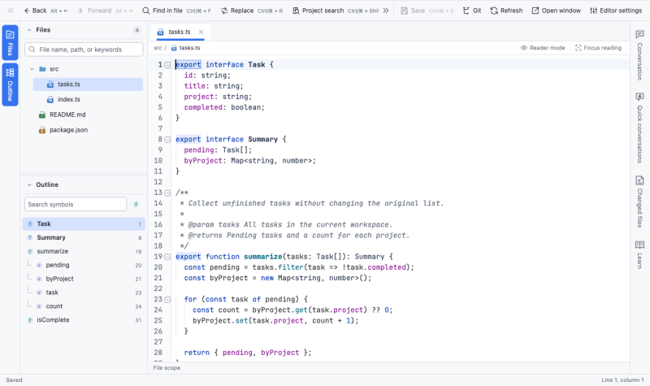
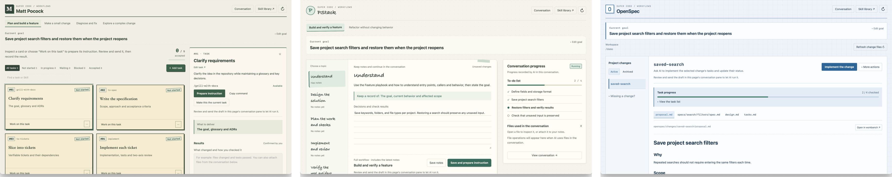
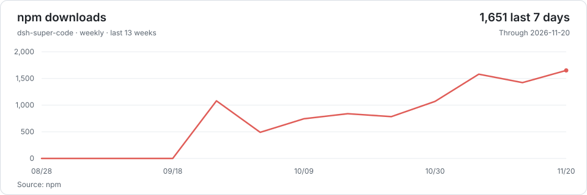
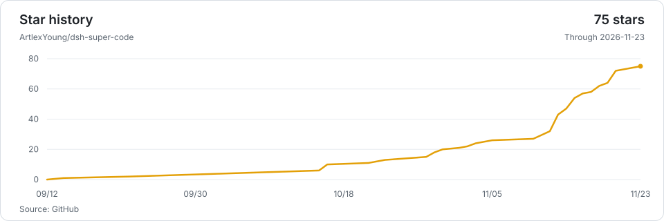

# dsh-super-code

[中文](README.md) · English

[](https://npmtrends.com/dsh-super-code) [](https://www.npmjs.com/package/dsh-super-code) [](docs/en/Compatibility.md) [](LICENSE)

A coding plugin for DeepSeek Harness designed to make development easier and use fewer tokens. It includes the Super Code preset, a code workbench, workflow consoles, Windows compatibility, and remote development support.

[Install](#3-install) · [Get started](#4-get-started) · [Workflow guide](docs/en/Workflows.md) · [Compatibility](docs/en/Compatibility.md) · [Evaluation](#5-evaluation)

# 1 Core features

## 1.1 Super Code preset

One preset for coding tasks.

1. **Batched tool calls** let you run several tools together in PTC mode.
2. **Layered memory** keeps tasks, project knowledge, and global preferences separate.
3. **Context budgets** use compression settings selected from previous evaluations by default.
4. **Deletion protection** prompts agents to move files to the trash so they can be recovered.
5. **Tool customization** lets you choose which tools the preset can use. Changes apply after the current turn.
6. **Remote projects** use `dsh-ssh-workspaces` to run commands on a server. Full remote sessions run Super Code on the server. Lightweight sessions keep task and memory tools and use `remote_bash` for commands and file edits. [Remote project guide](docs/en/UsageGuide.md#remote-projects)
7. **dsh-Go / NEXT** remote sessions can call tools and manage tasks and memory. [Remote control guide](docs/en/UsageGuide.md#dsh-go--dsh-next-remote-control)
8. **MCP connection** lets MCP-compatible coding tools delegate tasks to DSH. It is off by default.

> On SWE-bench Pro hard-100, all three configurations used DSH `0.2.1-rc.2`, the same model, and high reasoning effort.
>
> | | Official Standard + high | Super Code 0.3.11 | Super Code 0.4.0 |
> |---|---:|---:|---:|
> | Passed | 47/100 | 50/100 (+3 tasks) | **52/100 (+5 tasks)** |
> | Time per task | 16.26 min | 16.69 min (+2.7%) | 17.66 min (+8.6%) |
> | Tokens per task | 7.718 M | 6.673 M (-13.5%) | 6.895 M (-10.7%) |
> | Model calls per task | 89.54 | 76.44 (-14.6%) | 79.42 (-11.3%) |
>
> Results can vary between runs with the same configuration. [Historical results and methodology](docs/en/EvaluationResults.md)

## 1.2 Extension panels

### 1.2.1 Code Workbench

Read and edit code directly in DSH.

1. **Code editing** uses familiar controls from IntelliJ IDEA and VS Code in a lightweight editor.
2. **Git** shows repository status, changes, and function history. Compare files, manage branches, and push to remotes from the workbench.
3. **Background indexing** and caching help keep the editor responsive while it processes project files.
4. **Learning mode** explains code and implementation choices using the current project.

Explore more in the [Code Workbench guide](docs/en/CodeWorkbench.md).

[](docs/images/workbench-en.png)

### 1.2.2 Workflow consoles

Enable the corresponding workflow under **Settings → Super Code → Preset Skills** to show its console.

1. **Matt** uses task cards to break down work, set dependencies, and record what passed review.
2. **PStack** organizes notes by topic, including the current state, design decisions, implementation plans, and checks.
3. **OpenSpec** shows project change folders, proposals, designs, specifications, and task progress.

[](docs/images/workflows-en.png)

[Workflow guide](docs/en/Workflows.md) · [Update bundled Skills and dependencies automatically](docs/en/Workflows.md#maintaining-bundled-resources)

> The bundled Skills include Matt Pocock Skills, PStack, OpenSpec, grill-me, and oil-ui for requirements, specifications, UI design, and engineering work. The packs are off by default. Changes apply to existing conversations.

## 1.3 Windows compatibility

- **Command compatibility.** The Windows preset uses Bash by default so agents can run Bash commands directly. It uses Git Bash when available and falls back to the bundled Bash.
- **Workspace permission checks and repair.** If a program in a conversation's workspace fails to start or crashes on launch, open **Settings → Windows** in a desktop host that supports this feature. From there you can scan the local NTFS workspace and repair the affected directories.

# 2 Recent releases

**0.4.4**

- **Workflow consoles.** Matt, PStack, and OpenSpec each have a console tailored to their workflow.
- **Code Workbench.** On by default. Adds file renaming and moving, quick navigation, search and replace previews, Git hunk staging, and review of edits to selected code. Reopen the workbench to restore drafts, file tabs, and learning progress.
- **Lightweight SSH projects.** Commands and file edits use `remote_bash` to avoid writing to a local directory if the mount fails.
- **Windows compatibility.** The plugin rebuilds incomplete Bash caches and fixes OpenSpec startup on long installation paths. Desktop hosts with workspace permission repair can scan for and repair Low integrity labels left by the sandbox under **Settings → Windows**.
- **Harness compatibility.** Adds support for `0.2.3-alpha.1` and `0.2.3-alpha.2`. **Avoid the official `0.2.3-alpha.1` build due to a startup issue.**
- **Bug fixes.** Fixes preset language sync, tool inheritance on the first turn of child agents, persistent Bash shutdown timeouts on macOS, and guidance on arguments for global memory.
- **Bundled Skills and dependencies.** Updates oil-ui and the `marked` Markdown parser.

**0.4.3** adds tool profiles and the Code Workbench for code editing, Git, and learning. Settings, tools, memory, connections, and workbenches now have separate lifecycles.

**0.4.2** adds remote projects and dsh-Go / NEXT remote control. It also fixes task recovery, offline dependency resolution, long-path operations in Windows BusyBox, and image rendering.

[Full changelog](docs/en/Changelog.md)

Versions follow `major.performance.maintenance`. The second number changes for coding-result or efficiency improvements; the third covers fixes, UI, and compatibility. Releases go through regression testing, so intervals may be longer.

# 3 Install

Compatibility checks cover 17 DeepSeek Harness versions.

- `0.1.5-rc.3`, `0.1.7-rc.2`, and `0.2.0-rc.2`
- `0.2.1-rc.1` through `0.2.1-rc.5`
- `0.2.2-alpha.2`, `0.2.2-alpha.3`, and `0.2.2-rc.1` through `0.2.2-rc.5`
- `0.2.3-alpha.1` and `0.2.3-alpha.2`

[Compatibility record](docs/en/Compatibility.md)

> The official `0.2.3-alpha.1` build has a Cordis startup issue. Compatibility was checked with the affected components rebuilt from the matching source tag.

## 3.1 Desktop

Open **Plugins → Add plugin** in the left sidebar, enter `dsh-super-code`, then click **Install** and **Enable now**. On older versions, reload or restart when prompted. Desktop includes its own runtime, so Node.js is not required.

## 3.2 Web / CLI

Harness `0.2.2-alpha.2` through `0.2.3-alpha.1` requires Node.js `24.9.0` or later. For `0.2.3-alpha.2`, use `24.22.3` or later in the 24.x series, or `26.13.1` or later. The plugin itself supports Node.js `22.0.0`.

```bash
npm install -g @deepseek-ai/dsh            # skip if dsh is already installed
dsh plugin --profile web add dsh-super-code
```

<details>
<summary>Install from a Release package (including offline installation)</summary>

Download the `.tgz` file from [GitHub Releases](https://github.com/ArtlexYoung/dsh-super-code/releases).

Desktop: enter the full path of the package in "Package name or address", then click **Install**.

[Illustrated installation steps](docs/en/UsageGuide.md#installation-and-first-use)

Web: run the following command (use the actual file name):

```bash
dsh plugin --profile web add ./dsh-super-code-0.4.4.tgz
```

For offline installation, download the `.tgz` and install Harness in advance. For Web, add `--offline` to prevent the installer from making network requests.

```bash
dsh plugin --profile web add ./dsh-super-code-0.4.4.tgz --offline
```

</details>

# 4 Get started

[Full usage guide](docs/en/UsageGuide.md)

1. Open **Settings → Agent Presets** and select **Super Code** (identifier `super-code`).
2. Create a new session and describe the task.

The Code Workbench is on by default. To use a workflow console, enable its Skill pack under **Settings → Super Code → Preset Skills**. Models, reasoning effort, permissions, and tools follow the Harness settings. Child agents use the parent agent's model by default.

If the preset is not listed, check its status in **Settings → Super Code**, or see [troubleshooting](docs/en/UsageGuide.md#cant-find-the-preset).

[View settings and tool profiles](docs/en/UsageGuide.md#settings)

The **Super Code** right sidebar contains three sections:

- **Tasks**: goal, step progress, tool-call summaries, and changed files. Read-only.
- **Collaborative execution**: the Agent execution tree. Click a node to view details.
- **Memory**: view, add, edit, and delete project memory and global preferences.

Only one section is open at a time, with Tasks open by default. Clicking the active heading does not collapse it.

[](docs/images/task-status.png)

[More sidebar screenshots and instructions](docs/en/UsageGuide.md#sidebar)

_Screenshots use sample data and show the interface only._

# 5 Evaluation

## 5.1 Plugin comparison

The table shows the full SWE-bench Pro hard-100 results, sorted by tasks passed. All configurations use Harness `0.2.1-rc.2`, `Evaluation model B`, high reasoning effort, and legacy budgets. Each group reuses the same environment across its tasks.

| Configuration | Passed/valid | Mean total tokens (M) | Mean time (min) | Mean model calls | Mean tool calls | Cache rate |
|---|---:|---:|---:|---:|---:|---:|
| Super Code 0.3.5 | **51/100** | 6.435 | 24.751 | 76.660 | 75.840 | 98.927% |
| Official Standard | 50/100 | 8.030 | 17.198 | 91.990 | 113.880 | 99.167% |
| Unmodified dsh-ops 0.4.4 · Standard | 49/100 | 7.099 | 23.132 | 82.500 | 102.360 | 99.062% |
| Official Standard + billion-context 0.1.209 | 45/100 | 6.359 | 18.471 | 108.950 | 131.140 | 97.654% |
| Unmodified dsh-ops 0.4.4 · PTC | 44/100 | 7.322 | 23.695 | 81.490 | 80.960 | 99.056% |

M means one million tokens, including reasoning tokens. Time includes some in-run service waits. These additional results are recorded separately from the opening comparison and the historical budget experiments below. [See full results and methodology](docs/en/EvaluationResults.md#pro100-continuous-environment-comparison).

## 5.2 Method

- **Task set**: The official grader evaluates SWE-bench Pro hard-100. Tuning uses only 33 hard tasks selected from the SWE-bench dev split. Hard-100 is reserved for frozen-candidate evaluation and issue investigation, rather than tuning, to avoid overfitting to the evaluation tasks.
- **Baseline**: Comparisons use the official Standard preset and third-party plugin configurations. In the historical DSH `0.1.5-rc.2` comparison, Standard + high passed 51 tasks and Minimal + high passed 46, while Standard used 23.5% fewer tokens per task. Standard was therefore selected as the baseline.
- **Controlled variables**: Comparisons on the same DSH version keep the model, reasoning effort, and budgets fixed. Experiments across DSH versions or models are identified separately.
- **Metrics**: Results record tasks passed, mean total tokens, time, model and tool calls, and cache rate. The table above includes some in-run service waits; the historical budget experiments below use net time after excluding failed requests and retry waits.

## 5.3 Historical process

1. **DSH `0.1.5-rc.2` baseline** (`Evaluation model B`, high): the Super Code `0.3.0` candidate passed 56 tasks, the official Standard preset passed 51, and Minimal passed 46. Compared with Minimal, Super Code used 47.6% less time and 44.9% fewer tokens.
2. **Drop after moving to DSH `0.2.1-rc.2`**: with `Evaluation model B` and default budgets, Standard dropped to 46 and Super Code `0.3.4` to 41. Investigation found that DSH `0.2.1-rc.2` had reduced the context budgets: the compression threshold fell from 800,000 to 550,464 tokens, and retained verbatim context from 160,000 to 98,560 tokens.
3. **Retest with legacy budgets**: Standard remained at 46 with 14.2% more tokens. Super Code `0.3.5` rose to 49 with only 0.4% more tokens and 19.4% less net time. The plugin therefore uses legacy budgets by default from `0.3.6`.
4. **Cross-model check** (`glm-5.3-flash`, max): Super Code `0.3.4` passed 45 tasks and native ZCode passed 29. Super Code used less net time per task (32.9 vs 52.3 min) and more tokens (5.50 M vs 3.61 M).

## 5.4 Historical summary

These are earlier evaluation runs and are not pooled with the plugin comparison results above.

| Comparison | Passed | Efficiency |
|---|---|---|
| DSH `0.2.1-rc.2`, legacy budgets: Super Code `0.3.5` vs Standard + high | 49 vs 46 | Net time -21.3%, tokens -34.6%, model calls -25.5% |
| DSH `0.2.1-rc.2`, default budgets: Super Code `0.3.4` vs Standard + high | 41 vs 46 | Tokens -25.5%, net time +13.9% |
| DSH `0.1.5-rc.2`: Super Code `0.3.0` candidate vs Standard + high | 56 vs 51 | Raw time -34.9%, tokens -27.9% |
| DSH `0.1.5-rc.2`: Super Code `0.3.0` candidate vs Minimal + high | 56 vs 46 | Time -47.6%, tokens -44.9% |
| GLM-5.3-flash: Super Code `0.3.4` vs native ZCode | 45 vs 29 | Time -37.1%, tokens +52.4% |

## 5.5 Limitations

- Each configuration was run once. The same task can pass in one run and fail in another; run-to-run variance for a fixed configuration has not been estimated.
- The default-budget and legacy-budget runs used different plugin versions (`0.3.4` → `0.3.5`), so the gain cannot be attributed entirely to budgets.
- `0.3.6` – `0.3.10` have not been re-evaluated on the 100 tasks.
- The cross-model comparison is between two complete systems and cannot isolate the plugin's contribution.

[Results and methodology](docs/en/EvaluationResults.md) · [All result tables](eval/results/swebench-pro-final-100/ResultsTables.md)

# 6 Trends

**npm download trends**

<a href="https://npmtrends.com/dsh-super-code">
  <picture>
    <source media="(prefers-color-scheme: dark)" srcset="docs/images/npm-downloads-dark.svg">
    
  </picture>
</a>

**GitHub star history**

<a href="https://star-history.com/#ArtlexYoung/dsh-super-code&amp;Date">
  <picture>
    <source media="(prefers-color-scheme: dark)" srcset="docs/images/star-history-dark.svg">
    
  </picture>
</a>

# 7 Acknowledgements

Thanks to the [LINUX DO](https://linux.do) community.

| Project | Reference |
|---|---|
| [DeepSeek Harness](https://github.com/deepseek-ai/deepseek-harness) (MIT) | Provides Agents, sessions, tools, PTC, Skills, UI extensions |
| [ZCode](https://github.com/zai-org/ZCode) (Apache-2.0) | UI design |
| [Agent Skills](https://agentskills.io/specification) | File format of the frontend Skill |
| [oil-ui](https://github.com/oil-oil/oil-ui) (MIT) | Bundled frontend design Skill: design workflow, style comparisons, and rendered UI review |
| [OpenSpec](https://github.com/Fission-AI/OpenSpec) (MIT) | Specification-driven workflow Skill package |
| [Matt Pocock Skills](https://github.com/mattpocock/skills) (MIT) | Engineering workflow Skill package |
| [PStack](https://github.com/cursor/plugins/tree/main/pstack) (MIT) | Collaborative architecture, development, verification and review Skills |
| [SWE-bench](https://github.com/SWE-bench/SWE-bench), [SWE-bench Pro](https://github.com/scaleapi/SWE-bench_Pro-os) (code MIT) | Tuning and evaluation tasks |
| [js-yaml](https://github.com/nodeca/js-yaml), [Zod](https://github.com/colinhacks/zod) (MIT) | YAML parsing, data validation |

[Detailed acknowledgements and licenses](docs/en/Acknowledgements.md) · This project is licensed under [Apache-2.0](LICENSE).
