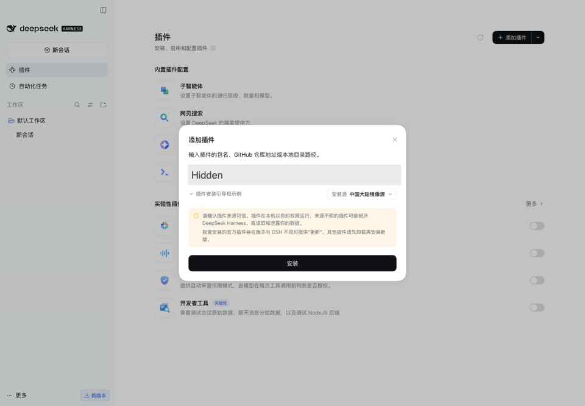
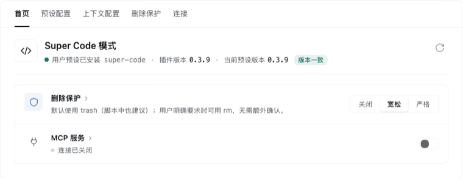
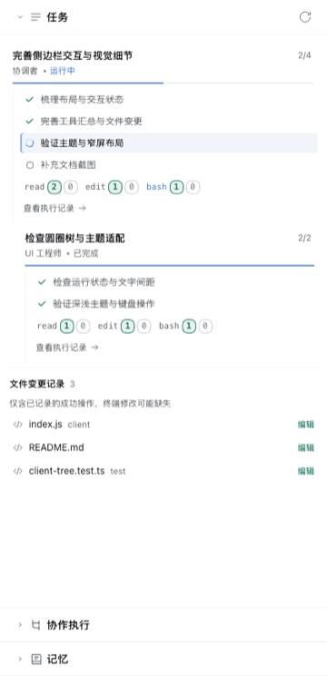
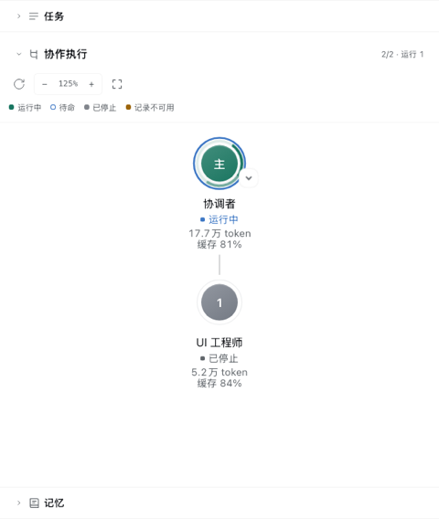

# dsh-super-code

[中文](README.md) · English

A smarter, leaner, faster, and easier-to-use coding plugin for DeepSeek Harness.

On SWE-bench Pro hard-100, compared with the official Standard preset (same host DSH `0.2.1-rc.2`, same model, both on high reasoning effort and legacy budgets):

| | Standard + high | Super Code |
|---|---:|---:|
| Passed | 46/100 | **49/100** |
| Net time per task | 20.9 min | **16.4 min** (-21.3%) |
| Tokens per task | 7.81 M | **5.11 M** (-34.6%) |
| Model calls per task | 92 | **69** (-25.5%) |

Tested on version `0.3.5`. [Full results and limitations](docs/en/EvaluationResults.md)

## Install

Supports Harness from `0.1.5-alpha.1`; see [compatibility](docs/en/Compatibility.md) for tested Web, official Desktop, and NEXT versions.

**Desktop**: open **Plugins → Add plugin** in the left sidebar, enter `dsh-super-code`, then click **Install** and **Enable now** (on older versions, reload or restart when prompted). Desktop includes its own runtime; Node.js is not required.

**Web / CLI**: requires Node.js 22 or later.

```bash
npm install -g @deepseek-ai/dsh            # skip if dsh is already installed
dsh plugin --profile web add dsh-super-code
```

<details>
<summary>Install from a Release package</summary>

Download the `.tgz` file from [GitHub Releases](https://github.com/ArtlexYoung/dsh-super-code/releases).

Desktop: enter the full path of the package in "Package name or address", then click **Install**.

[](docs/images/install-tgz.png)

Web: run the following command (use the actual file name):

```bash
dsh plugin --profile web add ./dsh-super-code-0.3.11.tgz
```

</details>

### Windows commands

Bundles GNU Bash, the required MSYS DLLs, BusyBox, and GNU grep, so Git does not need to be installed just to run Bash commands. Developer tools such as Git, Node, and Python still need separate installation. macOS and Linux keep the host environment.

Under **Settings → Super Code → Preset configuration → Command environment**, bundled Bash defaults on and **Also apply to official presets** defaults off. Enabling the latter covers Standard, PTC, and Create; Minimal retains its persistent terminal. Switches are editable only on Windows hosts, and are gray with a hover tooltip on other platforms.

In confined environments, Bash commands require DSH approval for that command. See the [usage guide](docs/en/UsageGuide.md#windows-command-environment) for configuration and compatibility limits.

## Usage

1. Open **Settings → Agent Presets** and select **Super Code** (identifier `super-code`).
2. Create a new session and describe the task.

Model, reasoning effort, permissions, and tools follow the Harness settings and need no separate configuration. Child Agents use the parent Agent's model by default.

If the preset is not listed, check its status in **Settings → Super Code**, or see [troubleshooting](docs/en/UsageGuide.md#cant-find-the-preset).

[](docs/images/preset-settings.png)

Select **Super Code** in the right sidebar. It contains three sections:

- **Tasks**: goal, step progress, tool-call summaries, and changed files. Read-only.
- **Collaborative execution**: the Agent execution tree. Click a node to view details.
- **Memory**: view, add, edit, and delete project memory and global preferences.

Exactly one of the three sections stays open. Tasks opens by default; clicking its heading keeps it expanded.

[](docs/images/task-status.png)

[](docs/images/agent-tree.png)

Screenshots use the current UI with sample data to illustrate the plugin.

## Features

| Feature | Description |
|---|---|
| Batched tool calls | Reads multiple files in parallel within one model call, reducing round trips |
| Layered memory | Current task, project lessons, and global preferences are stored separately, each with its source |
| Runtime budgets | Uses the better-performing legacy compression budgets by default; adjustable in Settings |
| Deletion protection | Directs Agents to use recoverable `trash` by default; can switch to strict confirmation |
| Windows commands | Bundled Bash and common utilities, optionally applied to official presets |
| MCP connection | Allows external MCP clients to delegate tasks to DSH. Off by default |
| Frontend Skill | Bundled oil-ui, loaded on demand for design, style comparisons, and rendered UI review |

See the [usage guide](docs/en/UsageGuide.md).

## Recent releases

- **0.3.11**: Fixed numerous bugs.
- **0.3.10**: Added bundled Bash on Windows and an official-preset switch, with legacy-host compatibility and tooltip fixes.
- **0.3.9**: Polished Settings and the task sidebar, improved MCP conversation control, fixed PTC child-tool approvals, and verified rc.4 Web compatibility.

[Full changelog](docs/en/Changelog.md)

Versions follow `major.performance.maintenance`: a change in the second number indicates improved coding results or efficiency; the third covers fixes, UI, and compatibility. Every release requires extensive regression testing, so the release cycle may be long.

## Evaluation

### Plugin comparison

Full SWE-bench Pro hard-100 results, sorted by tasks passed. All runs use Harness `0.2.1-rc.2`, `deepseek-v4.1-flash-1017`, high reasoning effort, and legacy budgets. Each group reuses its environment continuously across tasks.

| Configuration | Passed/valid | Mean total tokens (M) | Mean time (min) | Mean model calls | Mean tool calls | Cache rate |
|---|---:|---:|---:|---:|---:|---:|
| Super Code 0.3.5 | **51/100** | 6.435 | 24.751 | 76.660 | 75.840 | 98.927% |
| Official Standard | 50/100 | 8.030 | 17.198 | 91.990 | 113.880 | 99.167% |
| Unmodified dsh-ops 0.4.4 · Standard | 49/100 | 7.099 | 23.132 | 82.500 | 102.360 | 99.062% |
| Official Standard + billion-context 0.1.209 | 45/100 | 6.359 | 18.471 | 108.950 | 131.140 | 97.654% |
| Unmodified dsh-ops 0.4.4 · PTC | 44/100 | 7.322 | 23.695 | 81.490 | 80.960 | 99.056% |

M means one million tokens, including reasoning tokens. Time includes some in-run service waits. These additional results are recorded separately from the opening comparison and the historical budget experiments below. [Full results and methodology](docs/en/EvaluationResults.md#pro100-continuous-environment-comparison)

### Method

- **Task set**: SWE-bench Pro hard-100, graded with the official grader. Tuning uses only 33 hard tasks selected from the SWE-bench dev split; hard-100 is used only to evaluate frozen candidates and investigate issues, never for tuning, to avoid overfitting to the evaluation tasks.
- **Baselines**: the official Standard preset and third-party plugin configurations. In the historical official-preset comparison on the old host, Standard + high passed 51 tasks and Minimal + high passed 46, with Standard using 23.5% fewer tokens per task, so Standard was selected as the baseline.
- **Controlled variables**: comparisons on the same host keep model, reasoning effort, and budgets fixed while comparing preset and plugin combinations. Cross-host and cross-model experiments are identified separately.
- **Metrics**: tasks passed, mean total tokens, time, model and tool calls, and cache rate. The plugin comparison table above includes some in-run service waits; the historical budget experiments below use net time, excluding failed requests and retry waits.

### Historical process

1. **Old-host baseline** (DSH `0.1.5-rc.2`, `deepseek-v4.1-flash`, high): the Super Code `0.3.0` candidate passed 56 tasks, the official Standard preset 51, and Minimal 46. Relative to Minimal, time fell by 47.6% and tokens by 44.9%.
2. **Regression after the host upgrade**: after upgrading to DSH `0.2.1-rc.2` and `deepseek-v4.1-flash-1017`, under default budgets Standard dropped to 46 and Super Code `0.3.4` to 41, below Standard. Investigation found the new host had tightened context budgets: the compression threshold fell from 800,000 to 550,464 tokens, and retained verbatim context from 160,000 to 98,560 tokens.
3. **Retest with legacy budgets**: both sides used legacy budgets. Standard stayed at 46 with 14.2% more tokens; Super Code `0.3.5` rose to 49 with only 0.4% more tokens and 19.4% less net time. Based on this, the plugin uses legacy budgets by default from `0.3.6`.
4. **Cross-model check** (`glm-5.3-flash`, max): Super Code `0.3.4` passed 45 tasks and native ZCode 29. Super Code used less net time per task (32.9 vs 52.3 min) and more tokens (5.50 M vs 3.61 M).

### Historical summary

These are earlier evaluation runs and are not pooled with the plugin comparison results above.

| Comparison | Passed | Efficiency |
|---|---|---|
| New host, legacy budgets: Super Code `0.3.5` vs Standard + high | 49 vs 46 | Net time -21.3%, tokens -34.6%, model calls -25.5% |
| New host, default budgets: Super Code `0.3.4` vs Standard + high | 41 vs 46 | Tokens -25.5%, net time +13.9% |
| Old host: Super Code `0.3.0` candidate vs Standard + high | 56 vs 51 | Raw time -34.9%, tokens -27.9% |
| Old host: Super Code `0.3.0` candidate vs Minimal + high | 56 vs 46 | Time -47.6%, tokens -44.9% |
| GLM-5.3-flash: Super Code `0.3.4` vs native ZCode | 45 vs 29 | Time -37.1%, tokens +52.4% |

### Limitations

- Each configuration was run once. The same task can pass in one run and fail in another; run-to-run variance for a fixed configuration has not been estimated.
- The default-budget and legacy-budget runs used different plugin versions (`0.3.4` → `0.3.5`), so the gain cannot be attributed entirely to budgets.
- `0.3.6` – `0.3.11` have not been re-evaluated on the 100 tasks.
- The cross-model comparison is between two complete systems and cannot isolate the plugin's contribution.

[Results and methodology](docs/en/EvaluationResults.md) · [All result tables](eval/results/swebench-pro-final-100/ResultsTables.md)

## Acknowledgements

This project recognizes the [LINUX DO](https://linux.do) community.

| Project | Reference |
|---|---|
| [DeepSeek Harness](https://github.com/deepseek-ai/deepseek-harness) (MIT) | Host runtime: Agents, sessions, tools, PTC, Skills, UI extensions |
| [ZCode](https://github.com/zai-org/ZCode) (Apache-2.0) | UI design |
| [Agent Skills](https://agentskills.io/specification) | File format of the frontend Skill |
| [oil-ui](https://github.com/oil-oil/oil-ui) (MIT) | Bundled frontend design Skill: design workflow, style comparisons, and rendered UI review |
| [SWE-bench](https://github.com/SWE-bench/SWE-bench), [SWE-bench Pro](https://github.com/scaleapi/SWE-bench_Pro-os) (code MIT) | Tuning and evaluation tasks |
| [js-yaml](https://github.com/nodeca/js-yaml), [Zod](https://github.com/colinhacks/zod) (MIT) | YAML parsing, data validation |

[Detailed acknowledgements and licenses](docs/en/Acknowledgements.md) · This project is licensed under [Apache-2.0](LICENSE).
