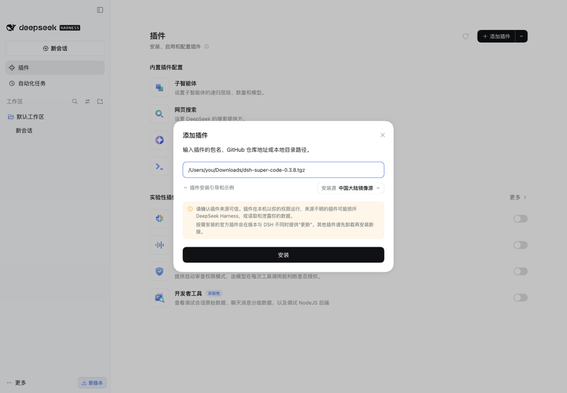

# dsh-super-code

[中文](README.md) · English

A smarter, leaner, faster, and easier-to-use coding plugin for DeepSeek Harness.

On SWE-bench Pro hard-100, compared with the official Standard preset (same host DSH `0.2.1-rc.2`, same model, both on high reasoning effort and legacy budgets):

| | Standard + high | Super Code |
|---|---:|---:|
| Passed | 46/100 | **49/100** |
| Net time per task | 20.9 min | **16.4 min** (-21.3%) |
| Tokens per task | 7.81 M | **5.11 M** (-34.6%) |
| Model calls per task | 92 | **69** (-25.5%) |

Tested on version `0.3.5`. [Full results and limitations](docs/en/EvaluationResults.md)

## Install

Supports Harness `0.1.5-alpha.1` – `0.2.1-rc.2`. See [compatibility](docs/en/Compatibility.md).

**Desktop**: open **Plugins → Add plugin** in the left sidebar, enter `dsh-super-code`, then click **Install** and **Enable now** (on older versions, reload or restart when prompted). Desktop includes its own runtime; Node.js is not required.

**Web / CLI**: requires Node.js 22 or later.

```bash
npm install -g @deepseek-ai/dsh            # skip if dsh is already installed
dsh plugin --profile web add dsh-super-code
```

<details>
<summary>Install from a Release package</summary>

Download the `.tgz` file from [GitHub Releases](https://github.com/ArtlexYoung/dsh-super-code/releases).

Desktop: enter the full path of the package in "Package name or address", then click **Install**.

[](docs/images/install-tgz.png)

Web: run the following command (use the actual file name):

```bash
dsh plugin --profile web add ./dsh-super-code-0.3.8.tgz
```

</details>

## Usage

1. Open **Settings → Agent Presets** and select **Super Code** (identifier `super-code`).
2. Create a new session and describe the task.

Model, reasoning effort, permissions, and tools follow the Harness settings and need no separate configuration. Child Agents use the parent Agent's model by default.

If the preset is not listed, check its status in **Settings → Super Code**, or see [troubleshooting](docs/en/UsageGuide.md#cant-find-the-preset).

[](docs/images/preset-settings.png)

Select **Super Code** in the right sidebar. It contains three sections:

- **Task status**: goal, step progress, actions performed, and files changed. Read-only.
- **Agent execution**: the Agent execution tree. Click a node to view details.
- **Memory library**: view, add, edit, and delete project memory and global preferences.

[](docs/images/agent-tree.png)

## Features

| Feature | Description |
|---|---|
| Batched tool calls | Reads multiple files in parallel within one model call, reducing round trips |
| Layered memory | Current task, project lessons, and global preferences are stored separately, each with its source |
| Runtime budgets | Uses the better-performing legacy compression budgets by default; adjustable in Settings |
| Deletion protection | Directs Agents to use recoverable `trash` by default; can switch to strict confirmation |
| MCP connection | Allows external MCP clients to delegate tasks to DSH. Off by default |
| Frontend Skill | Loaded on demand for UI work to check alignment, hit areas, and browser behavior |

See the [usage guide](docs/en/UsageGuide.md).

## Recent releases

- **0.3.8**: Added MCP connection; external clients can delegate, inspect, continue, and cancel DSH conversations. Added a Home overview in Settings.
- **0.3.7**: Added three-level deletion protection (Relaxed by default). Added Task status to the sidebar.
- **0.3.6**: Newer Harness versions tightened budgets and results declined; the plugin restores the legacy budgets by default.

[Full changelog](docs/en/Changelog.md)

Versions follow `major.performance.maintenance`: a change in the second number indicates improved coding results or efficiency; the third covers fixes, UI, and compatibility. Every release requires extensive regression testing, so the release cycle may be long.

## Evaluation

### Method

- **Task set**: SWE-bench Pro hard-100, graded with the official grader. Tuning uses only 33 hard tasks selected from the SWE-bench dev split; hard-100 is used only to evaluate frozen candidates and investigate issues, never for tuning, to avoid overfitting to the evaluation tasks.
- **Baseline**: the official Standard preset rather than Minimal. On the old host, Standard + high passed 51 tasks and Minimal + high passed 46, with Standard using 23.5% fewer tokens per task. Comparing against the stronger baseline gives a stricter conclusion.
- **Controlled variables**: same host, model, reasoning effort, and budgets; only the Agent preset differs.
- **Metrics**: tasks passed, net time per task (excluding failed requests and retry waits), tokens per task, and model calls per task.

### Process

1. **Old-host baseline** (DSH `0.1.5-rc.2`, `deepseek-v4.1-flash`, high): the Super Code `0.3.0` candidate passed 56 tasks, the official Standard preset 51, and Minimal 46. Relative to Minimal, time fell by 47.6% and tokens by 44.9%.
2. **Regression after the host upgrade**: after upgrading to DSH `0.2.1-rc.2` and `deepseek-v4.1-flash-1017`, under default budgets Standard dropped to 46 and Super Code `0.3.4` to 41, below Standard. Investigation found the new host had tightened context budgets: the compression threshold fell from 800,000 to 550,464 tokens, and retained verbatim context from 160,000 to 98,560 tokens.
3. **Retest with legacy budgets**: both sides used legacy budgets. Standard stayed at 46 with 14.2% more tokens; Super Code `0.3.5` rose to 49 with only 0.4% more tokens and 19.4% less net time. Based on this, the plugin uses legacy budgets by default from `0.3.6`.
4. **Cross-model check** (`glm-5.3-flash`, max): Super Code `0.3.4` passed 45 tasks and native ZCode 29. Super Code used less net time per task (32.9 vs 52.3 min) and more tokens (5.50 M vs 3.61 M).

### Summary

| Comparison | Passed | Efficiency |
|---|---|---|
| New host, legacy budgets: Super Code `0.3.5` vs Standard + high | 49 vs 46 | Net time -21.3%, tokens -34.6%, model calls -25.5% |
| New host, default budgets: Super Code `0.3.4` vs Standard + high | 41 vs 46 | Tokens -25.5%, net time +13.9% |
| Old host: Super Code `0.3.0` candidate vs Standard + high | 56 vs 51 | Raw time -34.9%, tokens -27.9% |
| Old host: Super Code `0.3.0` candidate vs Minimal + high | 56 vs 46 | Time -47.6%, tokens -44.9% |
| GLM-5.3-flash: Super Code `0.3.4` vs native ZCode | 45 vs 29 | Time -37.1%, tokens +52.4% |

### Limitations

- Each configuration was run once. The same task can pass in one run and fail in another; run-to-run variance for a fixed configuration has not been estimated.
- The default-budget and legacy-budget runs used different plugin versions (`0.3.4` → `0.3.5`), so the gain cannot be attributed entirely to budgets.
- `0.3.6` – `0.3.8` have not been re-evaluated on the 100 tasks.
- The cross-model comparison is between two complete systems and cannot isolate the plugin's contribution.

[Results and methodology](docs/en/EvaluationResults.md) · [All result tables](eval/results/swebench-pro-final-100/ResultsTables.md)

## Acknowledgements

This project recognizes the [LINUX DO](https://linux.do) community.

| Project | Reference |
|---|---|
| [DeepSeek Harness](https://github.com/deepseek-ai/deepseek-harness) (MIT) | Host runtime: Agents, sessions, tools, PTC, Skills, UI extensions |
| [ZCode](https://github.com/zai-org/ZCode) (Apache-2.0) | UI design |
| [Agent Skills](https://agentskills.io/specification) | File format of the frontend Skill |
| [Apple HIG](https://developer.apple.com/design/human-interface-guidelines), [WCAG 2.2](https://www.w3.org/TR/WCAG22/) | Interaction and accessibility principles in the frontend Skill |
| [SWE-bench](https://github.com/SWE-bench/SWE-bench), [SWE-bench Pro](https://github.com/scaleapi/SWE-bench_Pro-os) (code MIT) | Tuning and evaluation tasks |
| [js-yaml](https://github.com/nodeca/js-yaml), [Zod](https://github.com/colinhacks/zod) (MIT) | YAML parsing, data validation |

[Detailed acknowledgements and licenses](docs/en/Acknowledgements.md) · This project is licensed under [Apache-2.0](LICENSE).
