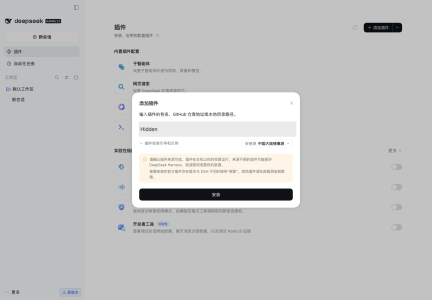
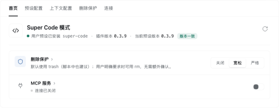
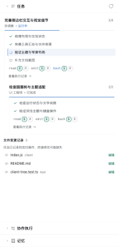
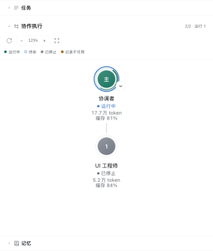

# dsh-super-code

[中文](README.md) · English

[](https://npmtrends.com/dsh-super-code) [](https://www.npmjs.com/package/dsh-super-code) [](docs/en/Compatibility.md) [](LICENSE)

A coding tool for DeepSeek Harness worth trying: smarter, leaner, and easier to use.

# 1 Features

## 1.1 A smarter preset

The **Super Code preset** brings coding-focused prompts and workflows together with task planning, tool collaboration, and project memory. Select the preset to get started.

- **Batched tool calls**: Read multiple files in parallel within one model call, with fewer round trips and less waiting while exploring code.
- **Layered memory**: Keep current tasks, project lessons, and global preferences separate. Reuse lessons across tasks, with a source for every record.
- **Runtime budgets**: Retain more context with compression budgets selected from historical evaluations, with adjustments available in Settings.
- **Deletion protection**: Guide Agents toward recoverable `trash` to reduce accidental deletion, with strict confirmation available when needed.
- **Windows command compatibility**: Bundled Bash and common utilities, without installing Git just to run Bash commands. Also available for official presets.

**Model outputs vary between runs. Read the results alongside the test configuration and methodology.**

On SWE-bench Pro hard-100, compared with the official Standard preset (same DSH version `0.2.1-rc.2`, same model, all on high reasoning effort):

| | Official Standard + high | Super Code 0.3.11 | Super Code 0.4.0 |
|---|---:|---:|---:|
| Passed | 47/100 | 50/100 (+3 tasks) | **52/100 (+5 tasks)** |
| Time per task | 16.26 min | 16.69 min (+2.7%) | 17.66 min (+8.6%) |
| Tokens per task | 7.718 M | 6.673 M (-13.5%) | 6.895 M (-10.7%) |
| Model calls per task | 89.54 | 76.44 (-14.6%) | 79.42 (-11.3%) |

Tested on 2026-11-11: [Historical results and methodology](docs/en/EvaluationResults.md)

## 1.2 A smoother development experience

The **Code Workbench** brings your workflow from an IDE into DSH, combining coding tools and model assistance in one place, ready to use.

- **Lightweight editor**: A familiar IntelliJ IDEA / VS Code experience for reading and editing project files directly in Harness, with less window switching.
- **Git**: Review repository status and code changes, and handle version-control operations including function change history (✨), file comparisons, branch management, and remote pushes.
- **Preset Skills (manual opt-in)**: Bundled grill-me, OpenSpec, oil-ui, Matt Pocock Skills, and PStack cover requirements, specifications, UI, and engineering workflows. All are off by default and take effect in existing conversations when enabled.
- **Learning mode**: Explore code and implementation decisions in the context of your project, learning as you build.

## 1.3 Remote support

- **Remote project support**: Use lightweight remote sessions with `dsh-ssh-workspaces` to run commands on the server, retain task and memory tools, and keep existing approval, cancellation, and disconnection checks. [Usage guide](docs/en/UsageGuide.md#remote-projects).
- **dsh-Go / NEXT remote control**: Enable Super Code on the machine running DSH, then call tools, manage tasks, and access memory through dsh-Go / NEXT remote conversations. See the [usage guide](docs/en/UsageGuide.md#dsh-go--dsh-next-remote-control) for native and web interface coverage.
- **MCP connection**: Let MCP-compatible AI coding tools delegate tasks to DSH and fit Super Code into your development workflow. Off by default.

## 1.4 And more

- **Feature isolation**: Settings, tools, memory, connections, and the workbench have separate lifecycles, so other features remain available when an optional capability fails.
- **Lightweight package**: Reuse the Harness runtime, models, and session capabilities through a plugin that fits into your existing development environment.

> Bundled and adapted Skill sources are published under [builtin/skills](builtin/skills), including provenance, licenses, and companion resources. See the [layout and maintenance guide](builtin/README.md).

# 2 Recent releases

- **0.4.2**: Added remote projects and dsh-Go / NEXT remote control, with fixes for task recovery after restart, offline dependency resolution in some installers, Windows BusyBox file operations on long paths, and README image rendering. See [compatibility](docs/en/Compatibility.md) for tested coverage and limits.
- **0.4.1**: Fixed Windows sessions failing to load on Harness `0.2.2-rc.2` ([#2](https://github.com/ArtlexYoung/dsh-super-code/issues/2)) and bundled runtime dependencies for local offline installation, while keeping Harness `0.1.5-alpha.1` as the minimum supported version.
- **0.4.0**: Simplified task and memory tools, added five opt-in Skill and workflow packages, and improved Settings, the task sidebar, and Harness compatibility.

[Full changelog](docs/en/Changelog.md)

Versions follow `major.performance.maintenance`: a change in the second number indicates improved coding results or efficiency; the third covers fixes, UI, and compatibility. Every release requires extensive regression testing, so the release cycle may be long.

# 3 Trends

**npm download trends**

<a href="https://npmtrends.com/dsh-super-code">
  <picture>
    <source media="(prefers-color-scheme: dark)" srcset="docs/images/npm-downloads-dark.svg">
    
  </picture>
</a>

**Star**

<a href="https://star-history.com/#ArtlexYoung/dsh-super-code&amp;Date">
  <picture>
    <source media="(prefers-color-scheme: dark)" srcset="docs/images/star-history-dark.svg">
    
  </picture>
</a>

# 4 Install

The current target covers 15 Harness versions: `0.1.5-rc.3`, `0.1.7-rc.2`, and `0.2.0-rc.2` from older series; `0.2.1-rc.1` through `rc.5`; and `0.2.2-alpha.2/alpha.3` plus `0.2.2-rc.1` through `rc.5`. Only alphas from the latest `0.2.2` series remain in release acceptance. Checks for the newly added `0.2.2-rc.5` are in progress; see [compatibility](docs/en/Compatibility.md) for actual platform results.

**Desktop**: open **Plugins → Add plugin** in the left sidebar, enter `dsh-super-code`, then click **Install** and **Enable now** (on older versions, reload or restart when prompted). Desktop includes its own runtime; Node.js is not required.

**Web / CLI**: use Node.js `24.9.0` or later. Harness declares this requirement starting with `0.2.2-alpha.2`. On macOS, each earlier Harness release from `0.1.5-alpha.1` through `0.2.1-rc.5` passed startup, deletion approval, and cold restart checks on Node.js `22.18.0`. The plugin itself supports Node.js `22.0.0`. The full Harness exits silently on that version.

```bash
npm install -g @deepseek-ai/dsh            # skip if dsh is already installed
dsh plugin --profile web add dsh-super-code
```

<details>
<summary>Install from a Release package (including offline installation)</summary>

Download the `.tgz` file from [GitHub Releases](https://github.com/ArtlexYoung/dsh-super-code/releases).

Desktop: enter the full path of the package in "Package name or address", then click **Install**.

[](docs/images/install-tgz.png)

Web: run the following command (use the actual file name):

```bash
dsh plugin --profile web add ./dsh-super-code-0.4.2.tgz
```

Starting with 0.4.1, the package includes the plugin runtime dependencies. Download the `.tgz` and install Harness before going offline. For Web, explicitly add `--offline` to prevent the installer from attempting network requests:

```bash
dsh plugin --profile web add ./dsh-super-code-0.4.2.tgz --offline
```

Version 0.4.2 fixes installers such as `pnpm 11.28.5` trying to fetch Harness dependencies during offline installation with an empty cache. Install Harness beforehand and continue to use explicit `--offline` for Web; see [compatibility](docs/en/Compatibility.md).

Cloud models still require network access. Local or LAN models require a reachable model service.

</details>

# 5 Usage

> See the [usage guide](docs/en/UsageGuide.md) for details.

1. Open **Settings → Agent Presets** and select **Super Code** (identifier `super-code`).
2. Create a new session and describe the task.

Model, reasoning effort, permissions, and tools follow the Harness settings and need no separate configuration. Child Agents use the parent Agent's model by default.

If the preset is not listed, check its status in **Settings → Super Code**, or see [troubleshooting](docs/en/UsageGuide.md#cant-find-the-preset).

[](docs/images/preset-settings.png)

Select **Super Code** in the right sidebar. It contains three sections:

- **Tasks**: goal, step progress, tool-call summaries, and changed files. Read-only.
- **Collaborative execution**: the Agent execution tree. Click a node to view details.
- **Memory**: view, add, edit, and delete project memory and global preferences.

Exactly one of the three sections stays open. Tasks opens by default; clicking its heading keeps it expanded.

[](docs/images/task-status.png) [](docs/images/agent-tree.png)

Screenshots use the current UI with sample data to illustrate the plugin.

# 6 Evaluation

## 6.1 Plugin comparison

Full SWE-bench Pro hard-100 results, sorted by tasks passed. All runs use Harness `0.2.1-rc.2`, `Evaluation model B`, high reasoning effort, and legacy budgets. Each group reuses its environment continuously across tasks.

| Configuration | Passed/valid | Mean total tokens (M) | Mean time (min) | Mean model calls | Mean tool calls | Cache rate |
|---|---:|---:|---:|---:|---:|---:|
| Super Code 0.3.5 | **51/100** | 6.435 | 24.751 | 76.660 | 75.840 | 98.927% |
| Official Standard | 50/100 | 8.030 | 17.198 | 91.990 | 113.880 | 99.167% |
| Unmodified dsh-ops 0.4.4 · Standard | 49/100 | 7.099 | 23.132 | 82.500 | 102.360 | 99.062% |
| Official Standard + billion-context 0.1.209 | 45/100 | 6.359 | 18.471 | 108.950 | 131.140 | 97.654% |
| Unmodified dsh-ops 0.4.4 · PTC | 44/100 | 7.322 | 23.695 | 81.490 | 80.960 | 99.056% |

M means one million tokens, including reasoning tokens. Time includes some in-run service waits. These additional results are recorded separately from the opening comparison and the historical budget experiments below. [Full results and methodology](docs/en/EvaluationResults.md#pro100-continuous-environment-comparison)

## 6.2 Method

- **Task set**: SWE-bench Pro hard-100, graded with the official grader. Tuning uses only 33 hard tasks selected from the SWE-bench dev split; hard-100 is used only to evaluate frozen candidates and investigate issues, never for tuning, to avoid overfitting to the evaluation tasks.
- **Baselines**: the official Standard preset and third-party plugin configurations. In the historical official-preset comparison on DSH `0.1.5-rc.2`, Standard + high passed 51 tasks and Minimal + high passed 46, with Standard using 23.5% fewer tokens per task, so Standard was selected as the baseline.
- **Controlled variables**: comparisons on the same DSH version keep model, reasoning effort, and budgets fixed while comparing preset and plugin combinations. Experiments across DSH versions and models are identified separately.
- **Metrics**: tasks passed, mean total tokens, time, model and tool calls, and cache rate. The plugin comparison table above includes some in-run service waits; the historical budget experiments below use net time, excluding failed requests and retry waits.

## 6.3 Historical process

1. **DSH `0.1.5-rc.2` baseline** (`Evaluation model B`, high): the Super Code `0.3.0` candidate passed 56 tasks, the official Standard preset 51, and Minimal 46. Relative to Minimal, time fell by 47.6% and tokens by 44.9%.
2. **Regression after upgrading to DSH `0.2.1-rc.2`**: after upgrading to DSH `0.2.1-rc.2` and `Evaluation model B`, under default budgets Standard dropped to 46 and Super Code `0.3.4` to 41, below Standard. Investigation found DSH `0.2.1-rc.2` had tightened context budgets: the compression threshold fell from 800,000 to 550,464 tokens, and retained verbatim context from 160,000 to 98,560 tokens.
3. **Retest with legacy budgets**: both sides used legacy budgets. Standard stayed at 46 with 14.2% more tokens; Super Code `0.3.5` rose to 49 with only 0.4% more tokens and 19.4% less net time. Based on this, the plugin uses legacy budgets by default from `0.3.6`.
4. **Cross-model check** (`glm-5.3-flash`, max): Super Code `0.3.4` passed 45 tasks and native ZCode 29. Super Code used less net time per task (32.9 vs 52.3 min) and more tokens (5.50 M vs 3.61 M).

## 6.4 Historical summary

These are earlier evaluation runs and are not pooled with the plugin comparison results above.

| Comparison | Passed | Efficiency |
|---|---|---|
| DSH `0.2.1-rc.2`, legacy budgets: Super Code `0.3.5` vs Standard + high | 49 vs 46 | Net time -21.3%, tokens -34.6%, model calls -25.5% |
| DSH `0.2.1-rc.2`, default budgets: Super Code `0.3.4` vs Standard + high | 41 vs 46 | Tokens -25.5%, net time +13.9% |
| DSH `0.1.5-rc.2`: Super Code `0.3.0` candidate vs Standard + high | 56 vs 51 | Raw time -34.9%, tokens -27.9% |
| DSH `0.1.5-rc.2`: Super Code `0.3.0` candidate vs Minimal + high | 56 vs 46 | Time -47.6%, tokens -44.9% |
| GLM-5.3-flash: Super Code `0.3.4` vs native ZCode | 45 vs 29 | Time -37.1%, tokens +52.4% |

## 6.5 Limitations

- Each configuration was run once. The same task can pass in one run and fail in another; run-to-run variance for a fixed configuration has not been estimated.
- The default-budget and legacy-budget runs used different plugin versions (`0.3.4` → `0.3.5`), so the gain cannot be attributed entirely to budgets.
- `0.3.6` – `0.3.10` have not been re-evaluated on the 100 tasks.
- The cross-model comparison is between two complete systems and cannot isolate the plugin's contribution.

[Results and methodology](docs/en/EvaluationResults.md) · [All result tables](eval/results/swebench-pro-final-100/ResultsTables.md)

# 7 Acknowledgements

This project recognizes the [LINUX DO](https://linux.do) community.

| Project | Reference |
|---|---|
| [DeepSeek Harness](https://github.com/deepseek-ai/deepseek-harness) (MIT) | Provides Agents, sessions, tools, PTC, Skills, UI extensions |
| [ZCode](https://github.com/zai-org/ZCode) (Apache-2.0) | UI design |
| [Agent Skills](https://agentskills.io/specification) | File format of the frontend Skill |
| [oil-ui](https://github.com/oil-oil/oil-ui) (MIT) | Bundled frontend design Skill: design workflow, style comparisons, and rendered UI review |
| [OpenSpec](https://github.com/Fission-AI/OpenSpec) (MIT) | Complete specification-driven workflow Skill package |
| [Matt Pocock Skills](https://github.com/mattpocock/skills) (MIT) | Complete engineering workflow Skill package |
| [PStack](https://github.com/cursor/plugins/tree/main/pstack) (MIT) | Collaborative architecture, development, verification and review Skills |
| [SWE-bench](https://github.com/SWE-bench/SWE-bench), [SWE-bench Pro](https://github.com/scaleapi/SWE-bench_Pro-os) (code MIT) | Tuning and evaluation tasks |
| [js-yaml](https://github.com/nodeca/js-yaml), [Zod](https://github.com/colinhacks/zod) (MIT) | YAML parsing, data validation |

[Detailed acknowledgements and licenses](docs/en/Acknowledgements.md) · This project is licensed under [Apache-2.0](LICENSE).
