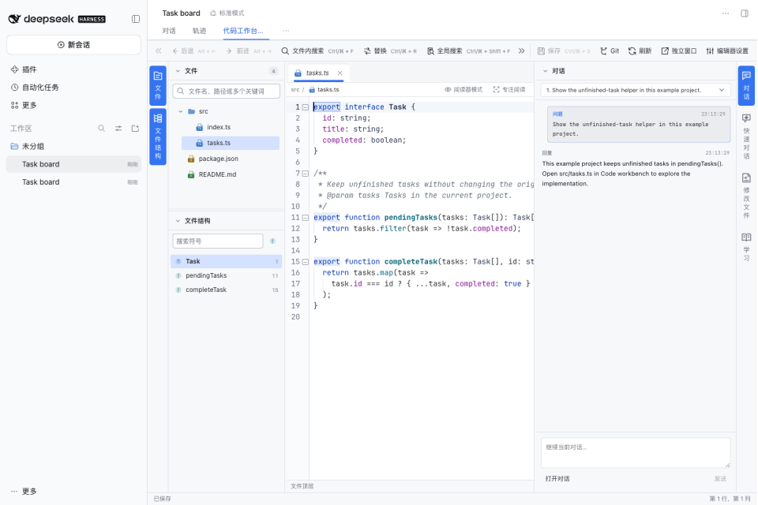
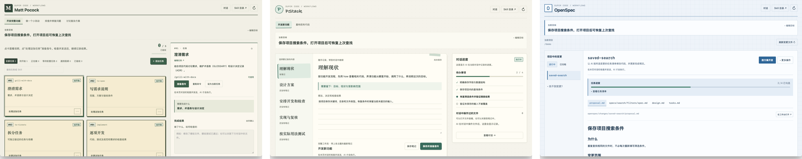
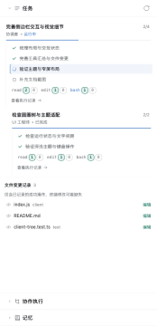
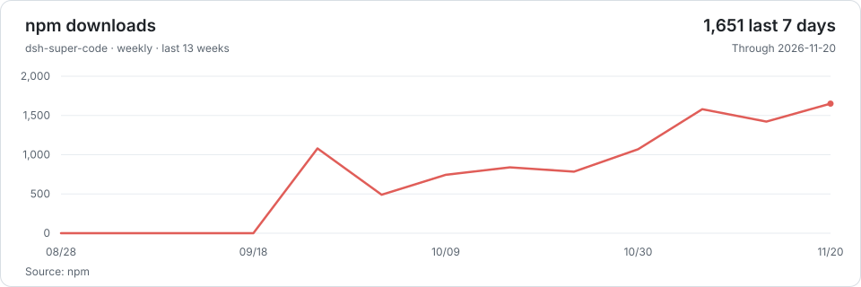

# dsh-super-code

中文 · [English](README.en.md)

[](https://npmtrends.com/dsh-super-code) [](https://www.npmjs.com/package/dsh-super-code) [](docs/Compatibility.md) [](LICENSE)

更聪明、更节省、更好用的 DeepSeek Harness 编程工具，包含 Super Code 编程预设、代码工作台、工作流工作台、Windows 兼容、远程支持以及更多功能。

[安装](#3-安装) · [开始使用](#4-使用) · [工作流说明](docs/Workflows.md) · [兼容性](docs/Compatibility.md) · [评测](#5-评测)

# 1 主要功能

## 1.1 Super Code 预设

一个预设搞定编码任务。

1. 批量工具调用：PTC 模式增强，支持批量调用工具。
2. 分层记忆：任务、项目经验和全局偏好分层管理。
3. 上下文预算：默认使用效果更好的压缩预算。
4. 删除保护：默认提示 Agent 使用删除至回收站，避免直接删除无法恢复。
5. 工具自定义：支持手动调整预设能够使用的工具，修改及时生效。
6. 远程项目：配合 `dsh-ssh-workspaces` 在服务器上执行命令，支持预设的所有功能。[查看使用说明](docs/UsageGuide.md#远程项目)。
7. dsh-Go / NEXT：支持从 dsh-Go / NEXT 的远程会话调用工具、管理任务和记忆。[使用说明](docs/UsageGuide.md#dsh-go--dsh-next-远程控制)。
8. MCP 连接：支持 MCP 的 AI 编码工具可以把任务交给 DSH 执行。此功能默认关闭。

> 在 SWE-bench Pro hard-100 上，与官方标准预设对比（同一 DSH 版本 `0.2.1-rc.2`、同一模型、均为 high 思考等级）：
>
>| | 官方标准 + high | Super Code 0.3.11 | Super Code 0.4.0 |
>|---|---:|---:|---:|
>| 通过 | 47/100 | 50/100（+3题） | **52/100（+5题）** |
>| 每题耗时 | 16.26 分钟 | 16.69 分钟（+2.7%） | 17.66 分钟（+8.6%） |
>| 每题 Token | 771.8 万 | 667.3 万（-13.5%） | 689.5 万（-10.7%） |
>| 每题模型调用 | 89.54 次 | 76.44 次（-14.6%） | 79.42 次（-11.3%） |
>
> 大模型输出会有波动，同一配置在不同批次中可能得到不同结果。[历史结果与评测口径](docs/EvaluationResults.md)

## 1.2 扩展面板
### 1.2.1 代码工作台

现在，你可以在 dsh 中阅读与编写代码了。

1. 代码编辑：接近 IDEA、VS Code 的轻量级体验，都是你最熟悉的。
2. Git：查看仓库状态和代码改动、处理函数变更历史、文件对比、分支管理和远程推送等操作。
3. 索引优化：做了很多的缓存、索引、异步等优化提升工作台性能。
4. 学习模式：结合当前项目讲解代码和实现思路。
5. 更多功能等待你的发现...
[](docs/images/workbench-zh.png)

### 1.2.2 工作流控制台

在「设置 → Super Code 模式 → 预置 Skill」启用对应的工作流后，才会出现。

1. Matt：用任务卡拆解工作、安排依赖并记录验收结果。
2. PStack：按主题记录现状、设计决定、开发安排和检查结果。
3. OpenSpec：浏览项目中的变更目录、提案、设计、规格和任务进度。

[](docs/images/workflows-zh.png)

[工作流使用指南](docs/Workflows.md) · [自动更新内置 Skill 与依赖](docs/Workflows.md#自动维护内置资源)

> 预置 Skill 中内置了 Matt Pocock Skills、PStack、OpenSpec、grill-me 和 oil-ui，覆盖需求梳理、规范、界面和工程开发。默认关闭，修改及时生效。

## 1.3 Windows 兼容

解决 Windows 使用中的常见问题，默认生效。

- 命令兼容：通过使用内置 Bash 替代 PowerShell，提升大模型命令执行成功率。
- 工作区权限检查与修复：如果存在对话的工作区（文件夹）中程序打不开或启动崩溃的情况，可以在「设置 → Windows」扫描本地 NTFS 工作区并进行修复。

# 2 最近更新

**0.4.4**

- 工作流控制台：新增 Matt、PStack、OpenSpec 的工作流控制台，各具特色。
- 代码工作台：更新为默认开启。新增文件改名与移动、快速定位、搜索替换预览、Git 按段暂存和选区修改审阅。新增持久化，重新打开工作台时可以恢复草稿、文件标签和学习进度。
- 轻量 SSH 项目：统一通过 `remote_bash` 执行，避免挂载失效时误本地目录。
- Windows 兼容优化：插件会自动重建不完整的内置 Bash 缓存，也修复了 OpenSpec 在长安装路径下无法启动的问题。支持工作区权限修复的桌面宿主可在「设置 → Windows」扫描和修复沙箱留下的低完整性标签。
- 兼容适配：增加 Harness `0.2.3-alpha.1` 和 `0.2.3-alpha.2`的适配**（官方的 `0.2.3-alpha.1` 版本有问题，不建议使用）**。
- 问题修复：修复预设语言同步、子 Agent 首轮工具继承、macOS 持久 Bash 退出超时和全局记忆的参数提示。
- 内置 Skill 和依赖更新：更新了内置 oil-ui 和 Markdown 解析依赖 `marked`。

**0.4.3**：新增工具方案和代码工作台，用于编辑代码、管理 Git 和学习项目；设置、工具、记忆、连接和工作台改为独立管理生命周期。

**0.4.2**：支持远程项目与 dsh-Go / NEXT 远程控制，修复任务恢复、离线依赖解析、Windows BusyBox 长路径操作及图片显示。

[完整版本记录](docs/Changelog.md)

版本号采用「主版本.效果版本.维护版本」。第二位变化表示编码效果或效率有提升，第三位用于修复、界面和兼容性更新。发布前会运行回归测试，因此更新间隔可能较长。

# 3 安装

验证过的的 DeepSeek Harness 版本（17个）：

- `0.1.5-rc.3`、`0.1.7-rc.2`、`0.2.0-rc.2`
- `0.2.1-rc.1` ～ `0.2.1-rc.5`
- `0.2.2-alpha.2`、`0.2.2-alpha.3`、`0.2.2-rc.1` ～ `0.2.2-rc.5`
- `0.2.3-alpha.1`、`0.2.3-alpha.2`

[兼容性记录](docs/Compatibility.md)

> 官方 `0.2.3-alpha.1` 版本存在 Cordis 启动问题，故验证的是修复相关组件代码后的兼容性。

## 3.1 桌面版

在左侧打开「插件 → 添加插件」，输入 `dsh-super-code`，依次点击「安装」和「立即启用」。旧版本请按提示重载或重启。桌面版自带运行环境，不需要另外安装 Node.js。

## 3.2 Web / 命令行版

Harness `0.2.2-alpha.2` 至 `0.2.3-alpha.1` 要求 Node.js `24.9.0` 或更新版本。`0.2.3-alpha.2` 需要 24.x 中的 `24.22.3` 及以上版本，或 `26.13.1` 及以上版本。插件单独运行时支持 Node.js `22.0.0`。

```bash
npm install -g @deepseek-ai/dsh            # 已安装 dsh 命令可跳过
dsh plugin --profile web add dsh-super-code
```

<details>
<summary>使用 Release 安装包（含离线安装）</summary>

从 [GitHub Releases](https://github.com/ArtlexYoung/dsh-super-code/releases) 下载 `.tgz` 文件。

桌面版：在「包名或地址」中填写安装包的完整路径，然后点击「安装」。

[安装图解](docs/UsageGuide.md#安装与首次使用)

Web 版：运行以下命令（文件名以实际下载的为准）：

```bash
dsh plugin --profile web add ./dsh-super-code-0.4.4.tgz
```

离线安装：安装前，请先下载 `.tgz` 并安装 Harness。Web 版还需要显式添加 `--offline`，避免安装器尝试联网：

```bash
dsh plugin --profile web add ./dsh-super-code-0.4.4.tgz --offline
```

</details>

# 4 开始使用

[完整使用说明](docs/UsageGuide.md)

1. 打开「设置 → Agent 预设」，选择 **Super Code 模式**（标识符 `super-code`）。
2. 新建会话，描述任务即可。

需要代码工作台或工作流页面时，再到「设置 → Super Code 模式」开启对应功能。模型、推理等级、权限和工具沿用 Harness 的设置；子 Agent 默认使用父 Agent 的模型。

若未找到预设，可在「设置 → Super Code 模式」中查看状态，或参阅[排查方法](docs/UsageGuide.md#找不到预设)。

[查看设置页与工具方案](docs/UsageGuide.md#设置页)

右侧的「Super Code」边栏包含三个部分：

- **任务**：目标、步骤进度、工具调用汇总和已修改的文件，只读。
- **协作执行**：Agent 执行树，点击节点可查看详情。
- **记忆**：查看、新增、编辑和删除项目记忆与全局偏好。

一次只展开一个部分，默认显示「任务」。再次点击当前标题不会将它收起。

[](docs/images/task-status.png)

[更多侧栏截图与操作说明](docs/UsageGuide.md#侧边栏)

_截图使用演示数据，仅用于展示界面。_

# 5 评测

## 5.1 插件方案对比

下表是 SWE-bench Pro hard-100 的完整成绩，按通过数量排序。所有方案均使用 Harness `0.2.1-rc.2`、`评测模型 B`、high 和旧预算；每组任务连续复用同一环境。

| 方案 | 通过/有效 | 平均总 Token（M） | 平均耗时（分钟） | 平均模型调用 | 平均工具调用 | 缓存率 |
|---|---:|---:|---:|---:|---:|---:|
| Super Code 0.3.5 | **51/100** | 6.435 | 24.751 | 76.660 | 75.840 | 98.927% |
| 官方标准 | 50/100 | 8.030 | 17.198 | 91.990 | 113.880 | 99.167% |
| 原版 dsh-ops 0.4.4 · 标准 | 49/100 | 7.099 | 23.132 | 82.500 | 102.360 | 99.062% |
| 官方标准＋billion-context 0.1.209 | 45/100 | 6.359 | 18.471 | 108.950 | 131.140 | 97.654% |
| 原版 dsh-ops 0.4.4 · PTC | 44/100 | 7.322 | 23.695 | 81.490 | 80.960 | 99.056% |

M 表示百万 Token，其中包含思考 Token。耗时包含部分运行内服务等待。这批追加成绩与开头的对比、下方的历史预算实验分别记录。[查看完整结果与口径](docs/EvaluationResults.md)

## 5.2 评测方法

- **题集**：使用官方评分器评测 SWE-bench Pro hard-100。调优只使用 SWE-bench dev 中筛选的 33 道困难题；hard-100 只用于评测冻结候选和排查问题，不参与调优，以免对评测题过拟合。
- **基线**：使用官方标准预设和第三方插件方案。历史对比中，DSH `0.1.5-rc.2` 的标准 + high 通过 51 题，minimal + high 通过 46 题，且标准每题 token 少 23.5%，因此选择标准预设作为基线。
- **控制变量**：在同一 DSH 版本下，保持模型、思考等级和预算不变，再比较不同预设和插件组合。跨 DSH 版本或跨模型的实验会单独注明。
- **指标**：记录通过数、平均总 Token、耗时、模型与工具调用次数和缓存率。上表的耗时包含部分运行内服务等待；下方历史预算实验使用净耗时，扣除失败请求和重试等待。

## 5.3 历史评测过程

1. **DSH `0.1.5-rc.2` 基线**（`评测模型 B`，high）：Super Code `0.3.0` 候选通过 56 题，官方标准预设通过 51 题，minimal 通过 46 题。与 minimal 相比，Super Code 耗时减少 47.6%，token 减少 44.9%。
2. **换到 DSH `0.2.1-rc.2` 后下降**：在 `评测模型 B` 和默认预算下，标准预设降至 46 题，Super Code `0.3.4` 降至 41 题。排查发现 DSH `0.2.1-rc.2` 收紧了上下文预算：压缩阈值从 800,000 降至 550,464 token，保留原文从 160,000 降至 98,560 token。
3. **恢复旧预算后复测**：标准预设仍通过 46 题，token 增加 14.2%；Super Code `0.3.5` 提升到 49 题，token 只增加 0.4%，净耗时减少 19.4%。因此，从 `0.3.6` 起，插件默认使用旧预算。
4. **跨模型验证**（`glm-5.3-flash`，max）：Super Code `0.3.4` 通过 45 题，原生 ZCode 通过 29 题。Super Code 每题净耗时更少（32.9 vs 52.3 分钟），token 更多（550 万 vs 361 万）。

## 5.4 历史结果汇总

以下为较早的评测批次，不与上述插件方案对比的成绩合并计算。

| 对比 | 通过 | 效率 |
|---|---|---|
| DSH `0.2.1-rc.2`、旧预算：Super Code `0.3.5` vs 标准 + high | 49 vs 46 | 净耗时 -21.3%，token -34.6%，模型调用 -25.5% |
| DSH `0.2.1-rc.2`、默认预算：Super Code `0.3.4` vs 标准 + high | 41 vs 46 | token -25.5%，净耗时 +13.9% |
| DSH `0.1.5-rc.2`：Super Code `0.3.0` 候选 vs 标准 + high | 56 vs 51 | 原始耗时 -34.9%，token -27.9% |
| DSH `0.1.5-rc.2`：Super Code `0.3.0` 候选 vs minimal + high | 56 vs 46 | 耗时 -47.6%，token -44.9% |
| GLM-5.3-flash：Super Code `0.3.4` vs 原生 ZCode | 45 vs 29 | 耗时 -37.1%，token +52.4% |

## 5.5 限制

- 每组配置只运行一轮。同一道题在不同轮次中结果可能不同，目前尚未估计固定配置下的随机波动。
- 默认预算与旧预算两组的插件版本不同（`0.3.4` → `0.3.5`），收益不能全部归因于预算。
- `0.3.6` ~ `0.3.10` 未重新运行 100 题评测。
- 跨模型对比是两套完整系统之间的比较，无法单独分离插件的贡献。

[评测结果与口径](docs/EvaluationResults.md) · [完整成绩表](eval/results/swebench-pro-final-100/ResultsTables.md)

# 6 趋势

**npm 下载趋势**

<a href="https://npmtrends.com/dsh-super-code">
  <picture>
    <source media="(prefers-color-scheme: dark)" srcset="docs/images/npm-downloads-dark.svg">
    
  </picture>
</a>

**GitHub Star 趋势**

<a href="https://star-history.com/#ArtlexYoung/dsh-super-code&amp;Date">
  <picture>
    <source media="(prefers-color-scheme: dark)" srcset="docs/images/star-history-dark.svg">
    
  </picture>
</a>

# 7 致谢

感谢 [LINUX DO](https://linux.do) 社区。

| 项目 | 参考内容 |
|---|---|
| [DeepSeek Harness](https://github.com/deepseek-ai/deepseek-harness)（MIT） | 提供 Agent、会话、工具、PTC、Skill、界面扩展 |
| [ZCode](https://github.com/zai-org/ZCode)（Apache-2.0） | 界面设计 |
| [Agent Skills](https://agentskills.io/specification) | 前端 Skill 的文件格式 |
| [oil-ui](https://github.com/oil-oil/oil-ui)（MIT） | 内置前端设计 Skill，提供设计流程、风格对比与画面评审 |
| [OpenSpec](https://github.com/Fission-AI/OpenSpec)（MIT） | 规范驱动工作流 Skill 包 |
| [Matt Pocock Skills](https://github.com/mattpocock/skills)（MIT） | 工程工作流 Skill 包 |
| [PStack](https://github.com/cursor/plugins/tree/main/pstack)（MIT） | 架构、开发、验证与评审的协作 Skill 包 |
| [SWE-bench](https://github.com/SWE-bench/SWE-bench)、[SWE-bench Pro](https://github.com/scaleapi/SWE-bench_Pro-os)（代码 MIT） | 调优题与评测题 |
| [js-yaml](https://github.com/nodeca/js-yaml)、[Zod](https://github.com/colinhacks/zod)（MIT） | YAML 解析、数据校验 |

[详细致谢与许可证](docs/Acknowledgements.md) · 本项目采用 [Apache-2.0](LICENSE) 许可证。
