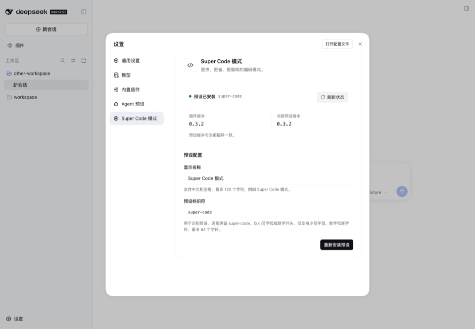
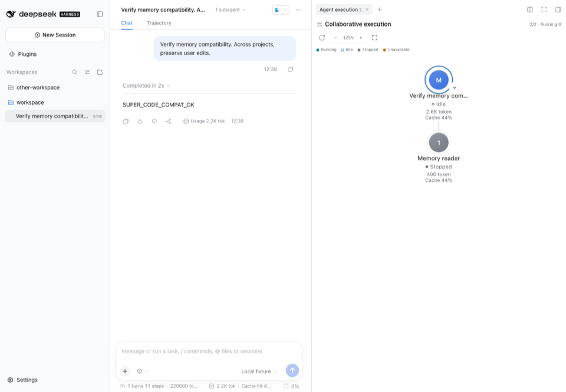

# dsh-super-code

一个更快、更节省、更聪明的 DeepSeek Harness 编码插件。简单任务直接做，复杂任务按需组织专业 Agent；任务状态和有来源的经验可以留到后续对话，不必反复交代。

A faster, more efficient coding plugin for DeepSeek Harness. It handles straightforward tasks directly, brings in specialist Agents when useful, and keeps sourced knowledge available for later conversations.

在同一组 SWE-bench Pro hard-100 中，0.3.0 的评测候选相比官方 minimal，平均回答耗时减少 **48%**、每题总 token 减少 **45%**、模型调用次数减少 **44.4%**，通过率从 **46% 提高到 56%**。[完整结果与限制](docs/EvaluationResults.md)

On the same SWE-bench Pro hard-100 set, the evaluation candidate for 0.3.0 uses **48% less response time**, **45% fewer total tokens**, and **44.4% fewer model calls**, with **56% passing versus 46%** for official minimal. [Full results and limitations](docs/EvaluationResults.md)

# 1 版本与更新 · Versions and Updates

为保证版本效果，发布前需要进行大量测试和回归验证，耗时较久，因此更新周期可能较长。

Extensive testing and regression checks are needed to verify each release's effectiveness. This takes time, so release cycles may be longer.

版本号采用 **主版本.效果优化版本.维护版本**，例如 `0.3.7`：

Version numbers follow **major.performance-improvement.maintenance**, for example `0.3.7`:

| 位置 / Position | 含义 / Meaning |
|---|---|
| 第一位 / First (`0`) | 主版本，仅在大范围重构时调整。 / Major version; changes only for extensive refactoring. |
| 第二位 / Second (`3`) | 效果优化版本，记录编码效果、效率等方面的优化。 / Performance-improvement version; tracks improvements to coding results, efficiency, and related capabilities. |
| 第三位 / Third (`7`) | 维护版本，记录问题修复、UI 优化、兼容性适配等更新。 / Maintenance version; tracks bug fixes, UI improvements, compatibility updates, and similar changes. |

## 0.3.7 · What's New

新增默认宽松的三档删除保护，以及全展开、虚拟滚动的任务状态侧栏。[更新详情](docs/Changelog.md)

Adds three deletion-protection modes, defaulting to Relaxed, and a fully expanded task-status sidebar with virtual scrolling. [Changelog](docs/Changelog.md)

## 0.3.6 · What's New

针对新版 Harness 预算收紧后的效果退化，新增预算配置并默认恢复此前效果更好的旧预算，无需手动填写。[更新详情](docs/Changelog.md)

Adds configurable budgets and restores the older, better-performing budgets without manual setup to address regressions observed after newer Harness versions reduced them. [Changelog](docs/Changelog.md)

## 0.3.5 · What's New

适配 Harness `0.2.1-rc.2`，修复 v4 会话日志升级后旧任务记录不可见的问题。[更新详情](docs/Changelog.md)

Supports Harness `0.2.1-rc.2` and restores legacy task records after v4 session-log upgrades. [Changelog](docs/Changelog.md)

[查看完整版本记录 · Full changelog](docs/Changelog.md)

# 2 开始使用 · Get Started

支持 Harness `0.1.5-alpha.1` 至 `0.2.1-rc.2`，按所用客户端选择安装方式；[各版本与客户端的验证范围](docs/Compatibility.md)。

Supports Harness `0.1.5-alpha.1` through `0.2.1-rc.2`. Choose the installation method for your client; see [validation coverage by version and client](docs/Compatibility.md).

## 2.1 安装 · Install

### 官方桌面版 · Official Desktop

打开左侧 **插件 → 添加插件**，在“包名或地址”中输入 `dsh-super-code`，点击 **安装**。新版安装完成后点击 **立即启用**；其他版本按提示重新加载或重启。桌面版自带运行环境，无需另外安装 Node.js。

Open **Plugins → Add plugin**, enter `dsh-super-code` in “Package name or address”, and click **Install**. On newer hosts, click **Enable now** when installation finishes; on other versions, reload or restart if prompted. The desktop app includes its runtime; no separate Node.js installation is needed.

### Web / 命令行版 · Web / CLI

需要 Node.js 22 或更高版本。通过 npm 安装 Harness，再添加插件；已有 `dsh` 命令时跳过第一行。

Requires Node.js 22 or later. Install Harness via npm, then add the plugin. Skip the first line if `dsh` is already installed.

```bash
npm install -g @deepseek-ai/dsh
dsh plugin --profile web add dsh-super-code
```

<details>
<summary>使用 Release 安装包（可选） · Install a Release package (optional)</summary>

从 [GitHub Releases](https://github.com/ArtlexYoung/dsh-super-code/releases) 下载 `.tgz` 包。桌面版在“包名或地址”中填入文件的完整路径；Web 版运行以下命令，将文件名替换为实际下载的版本。

Download a `.tgz` package from [GitHub Releases](https://github.com/ArtlexYoung/dsh-super-code/releases). On desktop, enter its full path in “Package name or address”. For Web, run the command below with the filename you downloaded.

```bash
dsh plugin --profile web add ./dsh-super-code-0.3.7.tgz
```

</details>

## 2.2 选中预设 · Select the Preset

打开 **设置 → Agent 预设**，选择 **Super Code 模式**（默认标识符 `super-code`）。

Open **Settings → Agent Presets** and choose **Super Code** (default identifier: `super-code`).

## 2.3 开始对话 · Start a Conversation

新建会话，描述你要完成的编码任务。模型、推理等级、权限和工具沿用 Harness 的设置；子 Agent 默认继承父 Agent 的模型，不用另配模型池。

Open a new session and describe the task. Models, reasoning effort, permissions, and tools come from Harness; child Agents inherit the parent's model by default.

没看到预设？在“设置”→ **Super Code** 查看状态；旧插件版本的入口在“插件配置”中。[安装与排查](docs/UsageGuide.md)

Can't find the preset? Open “Settings” → **Super Code**. Older plugin versions place this under “Plugin configuration”. [Setup and troubleshooting](docs/UsageGuide.md)

[](docs/images/preset-settings.png)

右侧 **Super Code** 页面依次展示任务状态、协作执行和记忆库，默认展开任务状态，点击标题切换。任务、步骤和已加载动作直接展开，虚拟滚动保持长列表流畅；保留圆圈 Agent 执行树及记忆的查看、新增、编辑和删除。任务状态只读取现有记录，不改变提示词或模型行为。[界面与记忆说明](docs/UsageGuide.md)

The **Super Code** sidebar contains Task status, Agent execution, and Memory library, with Task status open by default. Tasks, steps, and loaded activity stay expanded in a virtualized list. The circular Agent graph and memory browsing, creation, editing, and deletion remain available. Task status reads existing records without changing prompts or model behavior. [Interface and memory guide](docs/UsageGuide.md)

[](docs/images/agent-tree.png)

# 3 效果 · Results

当前版本迭代的效果优化均使用从 SWE-bench 官方 dev 集中筛选出的 **33 道有效困难题**；SWE-bench Pro hard-100 的 100 题用于候选冻结后的效果评测及 bug 排查，不参与效果调优。详见[评测口径与限制](docs/EvaluationResults.md)。

Current iterations are optimized on **33 valid difficult tasks selected from the official SWE-bench dev split**. The 100 SWE-bench Pro hard-100 tasks are used to evaluate frozen candidates and investigate bugs, not for performance tuning. See the [methodology and limitations](docs/EvaluationResults.md).

## 3.1 各版本成绩 · Version Results

五组均使用 **DSH `0.1.5-rc.2`**、**`deepseek-v4.1-flash`** 和 `high` 思考等级，完成同一批 100 题；评分环境异常已用原补丁复核。0.2.0 和 0.3.0 对应已评测的候选，耗时保留历史原始作答口径。

All five runs used **DSH `0.1.5-rc.2`**, **`deepseek-v4.1-flash`**, and `high` reasoning on the same 100 tasks. Grading anomalies were rechecked with the original patches. Versions 0.2.0 and 0.3.0 refer to evaluated candidates; times retain the historical response-time convention.

| 指标 / Metric | 官方 minimal + high | 0.0.9 | 0.1.2 | 0.2.0 | 0.3.0 |
|---|---:|---:|---:|---:|---:|
| 通过 / Passed | 46/100 | 50/100 | 53/100 | 54/100 | **56/100** |
| 平均耗时（历史）/ Original minutes per task | 25.685 | 16.458 | 16.011 | 15.148 | **13.461** |
| 平均总 token / Total tokens per task | 11,578,046.900 | 9,623,216.520 | 9,938,176.210 | 9,299,093.840 | **6,381,968.850** |
| 缓存输入 token/题 / Cached input | 11,404,101.120 | 9,461,981.440 | 9,775,799.040 | 9,142,005.760 | 6,231,823.360 |
| 模型调用/题 / Model calls | 124.660 | 92.780 | 99.780 | 93.830 | **69.290** |

五组均按相同规则复核。通过数已包含实际测试全部通过、仅因测试名称差异被误判的记录；用量和耗时保持原作答数据。修正依据见[评测说明](docs/EvaluationResults.md)。

All five runs were reviewed under the same rules. Pass counts include verified cases where every test passed but test-name differences caused a grading mismatch. Original usage and timing are unchanged. See the [evaluation report](docs/EvaluationResults.md) for correction evidence.

## 3.2 官方预设成绩 · Official Preset Results

本表使用 **DSH `0.1.5-rc.2`** 和 **`deepseek-v4.1-flash`**，思考等级按列标明；成绩包含后续原补丁复评与测试名称修正。各列只统计有效结果，未满 100 题的列不参与完整 100 题排名。

This table uses **DSH `0.1.5-rc.2`** and **`deepseek-v4.1-flash`**, with reasoning effort shown per column. Scores include subsequent original-patch regrades and verified test-name corrections. Each column uses valid scores only; incomplete columns are excluded from full 100-task rankings.

| 指标 / Metric | 极简 minimal + high | 极简 minimal + max | 标准 standard + high | PTC + high | 创造 creative + high | 标准 standard + max |
|---|---:|---:|---:|---:|---:|---:|
| 有效进度 / Valid scores | 100/100 | 100/100 | 100/100 | 100/100 | 100/100 | 99/100 |
| 通过/有效 / Passed / valid | 46/100 | 50/100 | 51/100 | 47/100 | 49/100 | 49/99 |
| 待环境复评 / Pending regrades | 0 | 0 | 0 | 0 | 0 | 0 |
| 原始分钟/题 / Original minutes | 25.685 | 32.529 | 20.683 | 17.302 | 19.856 | 20.452 |
| 净分钟/题 / Net minutes | 25.122 | 32.009 | 18.826 | 15.122 | 18.714 | 19.561 |
| 模型调用/题 / Model calls | 124.660 | 138.920 | 92.370 | 71.160 | 93.600 | 101.061 |
| 总 token/题 / Total tokens | 11,578,046.900 | 14,966,097.260 | 8,854,513.910 | 6,238,434.510 | 9,292,949.400 | 11,526,872.192 |
| 缓存输入 token/题 / Cached input | 11,404,101.120 | 14,770,140.160 | 8,713,578.230 | 6,099,266.510 | 9,145,025.240 | 11,349,317.818 |
| 非缓存输入 token/题 / Uncached input | 73,068.830 | 79,357.380 | 58,114.810 | 61,668.140 | 60,262.050 | 68,006.202 |
| 输出 token/题 / Output | 100,876.950 | 116,599.720 | 82,820.870 | 77,499.860 | 87,662.110 | 109,548.172 |
| 缺少用量的请求 / Requests without usage | 3 | 11 | 4 | 5 | 2 | 0 |

净耗时扣除最终有效作答中的失败请求和重试等待；两种耗时均不含官方评分。调用次数排除已记录的失败请求。总 token = 缓存输入 + 非缓存输入 + 输出，输出含思考 token。复评分保留原作答的用量和耗时；有效题目范围变化时，均值会随之变化。未返回的用量不估算，数字不等于完整账单。

Net time excludes failed requests and retry waits in the final valid answer; both time measures exclude grading. Call counts exclude logged failed requests. Total tokens = cached input + uncached input + output, including reasoning. Regrading preserves each answer's original usage and timing; means change when the valid subset changes. Missing usage is not estimated, so these figures are not a complete bill.

创造保留官方预设与工具定义；评测隔离禁止 `cordis_run` 在宿主上执行动态代码，只读检查仍可使用。极简 + high 复用历史基线，宿主修订与本轮不同，不能把差异完全归因于思考等级。

Creative retains the official preset and tools; evaluation isolation blocks host-side dynamic execution through `cordis_run`, while read-only inspection remains available. Minimal + high reuses a historical baseline with different Harness revisions, so the results do not isolate reasoning effort.

## 3.3 跨模型迁移 · Cross-Model Transfer

将模型换为 **`glm-5.3-flash`**，思考等级统一为 **`max`**，仍使用同一批 hard-100。两组均完成 100 题：Super Code 使用 **DSH `0.1.5-rc.2` + 插件 `0.3.4`**；对照使用完整原生 **ZCode Desktop `3.14.4` / CLI `0.16.9`**，没有抽取部分源码模拟 Agent。

Both runs completed the same hard-100 set using **`glm-5.3-flash`** with **`max`** reasoning. Super Code ran on **DSH `0.1.5-rc.2` + plugin `0.3.4`**; the comparison used the complete native **ZCode Desktop `3.14.4` / CLI `0.16.9`**, rather than an extracted Agent implementation.

| 指标 / Metric | DSH + Super Code 0.3.4 | 原生 ZCode / Native ZCode |
|---|---:|---:|
| 通过 / Passed | 44/100 | 28/100 |
| 净分钟/题 / Net minutes | 32.896 | 52.320 |
| 模型调用/题 / Model calls | 66.890 | 64.310 |
| 总 token/题 / Total tokens | 5,499,154.470 | 3,609,511.930 |
| 缓存输入 token/题 / Cached input | 5,302,796.160 | 3,356,862.720 |
| 缺少用量的请求 / Requests without usage | 29 | 120 |

这轮 Super Code 通过率高 **16 个百分点**，平均净耗时更少，但 token 更多。这说明方案可在 GLM 上运行并取得有效结果；对照比较的是两套完整系统，不能据此分离插件的贡献，也不能推及所有模型。缺失用量未估算。[测试脚本与记录](eval/glm/README.md)

Super Code passed **16 percentage points** more tasks and used less net time, but more tokens. This demonstrates working transfer to GLM in this run. The comparison covers two complete systems, so it neither isolates the plugin's contribution nor establishes gains across all models. Missing usage is not estimated. [Scripts and records](eval/glm/README.md)

## 3.4 新版 DSH 与预算 · New DSH and Budgets

以下四组均使用 **DSH `0.2.1-rc.2`**、新模型 **`deepseek-v4.1-flash-1017`**（调用标识 `deepseek/deepseek-flash`）和 **`high`** 思考，完成同一批 100 题。这里只展示官方预设与正式插件版本。

All four runs completed the same 100 tasks on **DSH `0.2.1-rc.2`**, using the newer **`deepseek-v4.1-flash-1017`** model (API ID: `deepseek/deepseek-flash`) with **`high`** reasoning. Only official presets and released plugin versions are shown here.

| 指标 / Metric | 标准 / Standard · 默认 / Default | Super Code 0.3.4 · 默认 / Default | 标准 / Standard · 旧预算 / Legacy | Super Code 0.3.5 · 旧预算 / Legacy |
|---|---:|---:|---:|---:|
| 通过/有效 / Passed / valid | 45/100 | 40/99 | 46/100 | 48/99 |
| 待核查 / Pending review | 0 | 1 | 0 | 1 |
| 净分钟/题 / Net minutes | 17.875 | 20.458 | 20.870 | 16.486 |
| 模型调用/题 / Model calls | 85.050 | 69.051 | 91.980 | 68.616 |
| 总 token/题 / Total tokens | 6,832,805.820 | 5,125,240.424 | 7,806,295.960 | 5,131,724.556 |
| 缓存输入 token/题 / Cached input | 6,710,566.400 | 5,008,071.111 | 7,679,298.560 | 5,016,822.909 |
| 缺少用量的请求 / Requests without usage | 0 | 0 | 0 | 1 |

两组 Super Code 各有一条 NodeBB 环境异常待核查，暂不计入有效评分和均值。npm 依赖已离线打包，但参考答案仍遇到初始化超时；原答案、判分记录和用量保留。

Each Super Code run has one NodeBB environment issue pending review, excluded from valid-score counts and means. npm dependencies are bundled offline, but reference setup still times out; original answers, verdicts, and usage are retained.

- **新版组合出现退化。** 相比旧 DSH / 旧模型，标准通过数从 51 降到 45，Super Code 从 0.3.0 候选的 56 降到 0.3.4 的 40；这同时涉及宿主、模型和插件版本变化。
- **预算是已定位的影响因素。** 新版更早压缩上下文、保留更少原文，PTC 执行时限也有变化。恢复旧预算后，Super Code 从 40 回升至 48，标准从 45 到 46。**0.3.6 已默认恢复旧预算**；表中验证组实际是 **0.3.5 + 显式旧预算**，不是另跑的 0.3.6 成绩。
- **结果仍有波动。** v4.1 的多轮实验中，同一道题存在一轮通过、另一轮失败的情况。后续版本会尝试改善这种不稳定性；各轮配置也有变化，本轮回升不代表已消除波动，也不能证明全部退化都由预算造成。

- **The newer combination regressed.** Standard fell from 51 passes on the older host/model to 45; Super Code fell from 56 for the 0.3.0 candidate to 40 for 0.3.4. Host, model, and plugin versions changed together.
- **Budgets are one identified factor.** The newer host compresses earlier, retains less verbatim context, and changes PTC execution deadlines. Restoring the older budgets raised Super Code from 40 to 48 and standard from 45 to 46. **Version 0.3.6 restores these defaults.** The measured row is **0.3.5 with explicit legacy budgets**, not a separate 0.3.6 run.
- **Run-to-run variation remains.** Across v4.1 experiments, the same task has both passed and failed. Future versions will aim to reduce this variability. Configurations also changed between runs; the recovery does not establish stability or attribute the entire regression to budgets.

[预算诊断、逐题记录与限制 · Budget diagnosis, per-task records, and limitations](docs/EvaluationResults.md#新版-dsh-与预算--new-dsh-and-budgets)

[多维指标、逐题证据与统计口径](docs/EvaluationResults.md)

[Detailed metrics, per-task evidence, and methodology](docs/EvaluationResults.md)

[使用说明 · Usage](docs/UsageGuide.md) · [兼容性 · Compatibility](docs/Compatibility.md) · [版本记录 · Changelog](docs/Changelog.md)

# 4 致谢 · Acknowledgements

本项目认可 [LINUX DO](https://linux.do) 社区。

This project recognizes the [LINUX DO](https://linux.do) community.

感谢以下项目与资料。具体贡献、借鉴范围和许可证说明见[详细致谢文档](docs/Acknowledgements.md)。

Thanks to the projects and resources below. See the [detailed acknowledgements](docs/Acknowledgements.md) for contributions, design references, and license notes.

| 项目 / Reference | 类型与许可证 / Type and license | 贡献与借鉴 / Contribution and influence |
| --- | --- | --- |
| [DeepSeek Harness](https://github.com/deepseek-ai/deepseek-harness) | 宿主 / Harness，MIT | Agent、会话、工具、PTC、Skill 与 Web / 桌面扩展接口 / Agents, sessions, tools, PTC, Skills, Web and desktop APIs |
| [ZCode](https://github.com/zai-org/ZCode) | UI 设计参考 / UI reference，Apache-2.0 | 紧凑布局、视觉层级、设置分组与交互状态 / Compact layouts, hierarchy, settings groups, interaction states |
| [Agent Skills](https://agentskills.io/specification) | 开放规范 / Open specification，Apache-2.0 | SKILL.md、元数据、参考目录与按需加载 / SKILL.md, metadata, resource directories, progressive disclosure |
| [Apple Human Interface Guidelines](https://developer.apple.com/design/human-interface-guidelines) | 设计指南，官方文档条款 / Design guidance, documentation terms | 前端 Skill 的布局、操作负担与反馈原则 / Layout, ergonomic controls, feedback guidance for the frontend Skill |
| [W3C WCAG 2.2](https://www.w3.org/TR/WCAG22/) | Web 无障碍标准，W3C 文档条款 / Accessibility standard, W3C document terms | 操作目标尺寸、间距与浏览器验证 / Target size, spacing, browser validation |
| [SWE-bench](https://github.com/SWE-bench/SWE-bench) | 评测代码 MIT；数据另见条款 / MIT code; separate data terms | dev 集有效困难 33 题的来源与评分基础 / Source and grading foundation for the 33 valid difficult dev tasks |
| [SWE-bench Pro](https://github.com/scaleapi/SWE-bench_Pro-os) | 评测代码 MIT；数据另见条款 / MIT code; separate data terms | 冻结候选的 hard-100 评测与 bug 排查 / Frozen-candidate hard-100 evaluation and bug investigation |
| [js-yaml](https://github.com/nodeca/js-yaml) / [Zod](https://github.com/colinhacks/zod) | 运行依赖 / Runtime dependencies，MIT | YAML 解析与数据校验 / YAML parsing and data validation |
