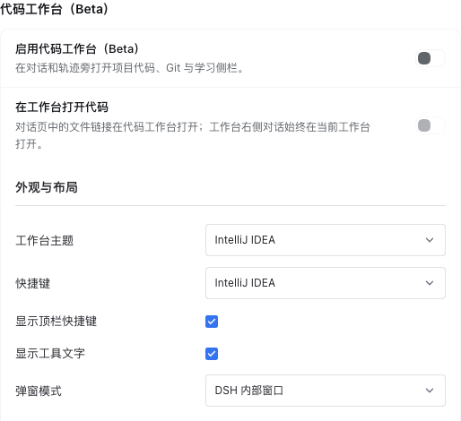
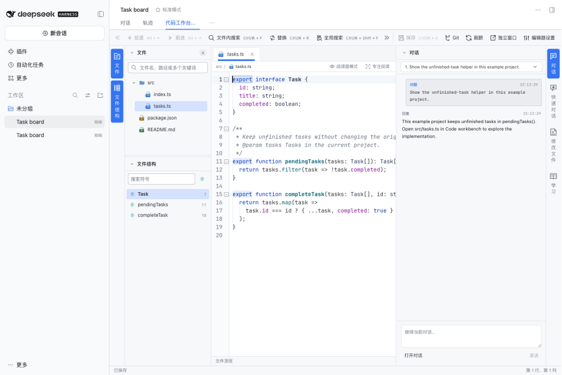
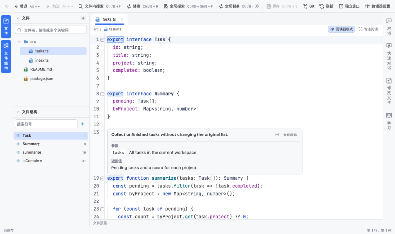

# 代码工作台

中文 · [English](en/CodeWorkbench.md)

## 开启与进入工作台

1. 打开「设置 → Super Code 模式 → 代码工作台」。
2. 打开下图第一个开关「启用代码工作台（Beta）」。开关默认关闭，修改后立即生效，并保存在当前客户端；开启和关闭不会初始化项目或修改预设。

[](images/workbench-settings-zh.png)

3. 回到已选择工作目录的会话，点击「对话」旁的「代码工作台」标签，再从左侧文件树选择文件。

[](images/workbench-zh.png)

- 左侧「文件」浏览项目，「文件结构」定位当前文件中的声明，两项都可以单独折叠。
- 中间直接编辑，点击「保存」或按 Ctrl/⌘+S 写入文件，沿用当前会话的访问权限。
- 顶部可打开 Git、独立窗口和编辑器设置。右侧竖栏按需展开对话、快速对话、修改文件与学习；图中展开了当前会话的对话侧栏，可一边读代码一边继续对话。

第二个开关「在工作台打开代码」控制普通「对话」页里的文件链接。希望点击这些链接时自动进入工作台，再开启它；它也默认关闭，与启用工作台是两个独立设置。

工作台总览、设置和工具方案截图来自隔离的 Harness 界面，使用演示项目与示例对话；阅读器图片展示同一工作台组件。点击图片可查看原图。

## 阅读与导航

通过「在工作台打开代码」打开的对话文件链接会定位到对应行。工作台右侧对话沿用宿主的路径识别，点击文件始终在当前工作台打开，不受此开关影响。关闭代码工作台时，对话页仍使用宿主原有预览。

文件打开不等待整个项目的代码索引；索引在后台继续，未完成时也可以阅读、编辑和切换文件。

鼠标前进、后退键和顶栏导航按光标位置回到同一文件或其他文件，不只切换标签；拖选和连续输入不会产生逐字历史。每个分栏与独立窗口单独保留位置记录。

全局搜索边扫描边展示结果，长列表只渲染可见行。文件版本未变时，搜索过滤器可跳过不可能命中的文件；短查询、Unicode 查询或缺少可靠版本时仍完整读取。可重建元数据保存在下述项目后台索引中，不写入源码或未保存的缓冲。

代码默认使用内嵌 JetBrains Mono、14px 字号与 1.5 倍行距。字体包含可变普通体与可变斜体，支持 100–800 字重，可离线使用。在编辑器设置或 Super Code 设置的「阅读与字体」中，可分别选择英文代码字体与中文回退字体，并调整字号与行距；中文默认使用系统回退，已有字体选择继续保留。设置实时保存并同步当前客户端的会话和独立窗口；修改自动保存、模型或工具栏等设置时，保留当前阅读文档和键盘焦点。

打开设置会自动检测本机字体，按家族列出可用选项，也可点击「刷新字体」。支持完整字体枚举的浏览器提供授权入口；其他环境使用系统候选并核对当前客户端是否可用，远程连接时不会直接把服务器字体当作本机字体，列表可能不完整。已选择但本机未检测到的字体仍保留，并提示使用回退字体。检测不安装字体、不读取项目文件。

「阅读器模式」默认关闭，可在当前文件路径右侧切换。开启后，代码字号增加 1px，行距按至少 1.65 倍计算并取整像素，文档块沿用相同行高。注释使用正体并提高对比度，长行随代码区宽度自动换行。原始行号、源码、选区和撤销记录保持不变。关闭模式后恢复横向滚动，Git 差异视图保持逐行对齐。

[](images/workbench-reader-zh.png)

独立多行 `/** … */` 文档注释和 Python 模块、类、函数开头的文档字符串会在原始行号旁按源码缩进排版。空间不足时，较长的文档会先显示摘要，可用「展开文档」查看说明、参数、返回值和示例。宽窗默认展开。IDEA 主题使用浅底圆角卡片和方框展开按钮，VS Code 主题使用正文底色、细侧线和箭头。点击「查看源码」、搜索命中或选区进入文档时会恢复原文，可以继续编辑、选区提问与撤销。排版只处理当前可见范围内的文档，超长文档保留源码的虚拟显示。

IDEA 阅读器在紧邻的函数、方法和类型声明前画细分隔线。已有空行或文档时沿用原来的间隔。VS Code 阅读器用循环的三种颜色标记语法树里的圆括号、方括号和花括号层次。同一对使用同一种颜色，字符串或注释中的普通括号保留原色。仅提供词法着色的语言沿用原来的样式。

多行签名滚过顶部时，粘性标题显示已滚出视口的部分，正文中仍可读的参数留在原行。悬停标题可查看完整签名，鼠标在标题上也能继续滚动正文。IDEA 在粘性行号旁显示方框折叠标记，VS Code 在悬停标题区或聚焦控件时显示箭头。折叠后可以点击正文占位符或按 Enter 展开。阅读器跟随滚动位置时，缩进高亮也随当前代码块移动。

在窄工作台里，两侧面板会让出空间给源码。点击文件路径右侧的「专注阅读」，可以暂时隐藏当前窗口的两侧面板和竖栏，同时继续使用文件标签和编辑操作。再次点击恢复面板，保留原来的展开项和宽度。专注阅读可与阅读器模式搭配使用，每个完整工作台窗口单独切换。

「滚动时保留作用域标题」默认开启，滚动到长函数中间时，顶部保留最多三层声明。跨行签名会合为一行，正文横向滚动时签名开头继续可见。点击标题跳到声明首行，可用前进和后退往返。单个光标在屏外且没有选中文字时，后退会回到点击前正在阅读的段落。它复用语言组件已有的语法树，纯文本和只提供词法着色的旧语言模式不推测作用域。Git 差异视图继续使用对齐的固定行高。

代码区按实际空格和 Tab 展示浅色缩进线，当前代码块的引导线会加深，包含块内空白行。IDEA 在底部显示类、函数及其嵌套关系，VS Code 将它们放在顶部的文件路径中。VS Code 编辑区较窄时，顶部阅读按钮保留图标和悬停提示，为当前类或方法留出空间。阅读器开启后，单个光标滚出可见正文时，路径和文件结构跟随当前阅读位置。IDEA 在底部标记「阅读位置」，VS Code 用小图标和高亮符号标示。这个定位也适用于关闭粘性标题的窗口，选择文字时仍以光标为准。点击名称可回到声明，使用后退可以回到刚才阅读的正文。主页面及独立窗口各自跟踪本地视图，作用域直接使用当前文件已有的语法树。

方法调用沿用函数颜色，普通属性保持属性颜色。IDEA 主题使用分隔行号栏、加粗的类型和函数声明、方框折叠标记和圆角文档块，带引导线的长行换行后在源码缩进后多留两列。VS Code 主题使用当前行细边框、悬浮时加深的折叠箭头和带侧边线的文档块，续行沿源码缩进对齐。文件结构用各主题的类型图标标记语法树能确认的类与类型声明。两套主题跟随宿主明暗设置，文档在窄编辑区内改为单列，续行缩进也会随可用宽度收紧。

文件结构与定义、用法导航共用声明索引。JS/TS 的普通赋值和累加不再列成新声明，循环中的显式绑定会保留；Python、PHP 在同一作用域只列首次赋值，参数及已声明的外部绑定不会因再次写入而重复出现。Go 的多变量声明保留全部名字，短声明区分当前代码块内的旧变量与新变量。不同作用域中的同名声明仍保留，不按名称直接合并。

文件结构按源码归属缩进，各类下的方法和函数下的嵌套声明一眼可分。IDEA 用圆形方法图标和转角引导线，VS Code 用线形方法图标和紧凑竖线。阅读器浏览时隐藏已确认的普通局部变量，搜索仍能定位这些变量。暂未解析的部分和只有词法着色的语言保留符号。

文件结构支持按名称搜索和「只看函数」。搜索结果显示所属类型或函数，可以用 `类名.方法名` 定位同名项。搜索忽略大小写及两端空白，保留源码顺序和不同位置的同名声明；直接赋给变量的箭头函数、匿名函数和 lambda 也按函数分类。搜索框内用上下方向键选择，Enter 跳到源码；Esc 先清空搜索，再次按下返回编辑器。切换文件会重置搜索和筛选，主页面与独立窗口各自保留查找状态。长列表只渲染可见行，搜索不读取项目文件或调用模型。

未搜索时，文件结构中的细线标注当前类或函数，键盘候选单独高亮。搜索期间保留候选和输入焦点。语法树或索引尚未覆盖当前位置时保留原列表位置，更新后再跟随。

光标停在单词上时，可见代码中的完整同名词会自动高亮，光标所在词加细边框。手动选中文字可匹配子串。阅读器跟随滚动位置时，屏外光标的同词提示会暂时隐藏。查找栏开启时用暖色突出命中，当前命中带边框。选区与光标仍留在源码里。

光标放在函数调用的括号内，IDEA 快捷键使用 Ctrl/⌘+P，VS Code 快捷键使用 Ctrl/⌘+Shift+Space，可打开「参数信息」；也可从顶栏打开或自定义快捷键。气泡显示项目中的签名、类型和当前参数说明，并强调当前参数；完整文档仍可悬浮函数名查看。在同一调用内移动光标会更新，进入嵌套调用会切换签名，Esc、离开调用或切换文件后关闭。函数形参优先绑定所属函数；JS/TS 相对导入和 Python 项目模块导入按实际来源解析，不混入其他模块的同名函数。确实无法唯一确定时，候选以紧凑列表显示，点击可展开完整文档。从定义或用法列表定位后关闭面板，全局搜索保留。命名参数按名称对应；展开参数、隐式接收者等无法可靠对应时保留完整签名。只读取项目已有信息，不调用模型。

文件读取或语言组件加载期间，切换文件、前进和后退会取消旧导航。加载完成时使用最新共享内容，不覆盖其他窗口刚产生的编辑和选区问答；加载失败不会留下未打开的文件标签。切换项目会清理旧目录、文件剪贴板和操作面板。

工作台独立于预设，可在官方预设、Super Code 模式和第三方预设的会话中使用，沿用当前会话的工作目录、模型和访问权限。右侧对话中的文件按钮、普通链接与图标跟随正文的小字号，仍使用宿主的文件识别与打开方式。

进入工作台时，右侧默认展示当前对话已写入日志的消息与工具记录，并带短暂过渡动画；系统开启减少动态效果时不播放。右侧输入框与「对话」共用草稿，通过宿主的输入动作继续同一会话，不创建新会话、不改变提示词或模型。连续工具记录默认收成工具名与成功、失败次数，次数为 0 的标签不显示；展开可查看原始调用和结果。顶部问题条定位本页已加载的问题，「回到底部」恢复跟随最新消息；更早记录仍可分页加载。右侧「对话」与「修改文件」可分别折叠，修改文件默认收起。逐字输出、审批和引用或附件操作仍在完整「对话」页，原草稿会保留。记录复用插件已有的消息渲染，不是宿主完整聊天界面的副本；缺少公共输入接口的宿主提供返回对话入口。

左侧竖栏提供「文件」「文件结构」，右侧竖栏提供「对话」「快速对话」「修改文件」「学习」，可逐项展开或收起；一侧全部收起后，空间会留给代码。学习与对话可同时展开，学习默认收起，开关不会自动发起模型请求。左侧浏览和编辑当前会话的源码，在学习区输入想弄懂的问题，生成按概念和处理过程组织的阅读路径；点击步骤逐段查看解释，点击文件引用可选中对应源码。「解释当前文件」无需先生成路径。收起保留阅读目标、对话草稿、当前文件、选区与编辑状态。

拖动目录与代码区之间的分隔条可调整文件目录宽度，右侧栏也可单独调整；左侧「文件」与「文件结构」可分别折叠，并拖动中间分隔条调整高度。尺寸与折叠状态会在当前客户端记忆，分隔条支持方向键调整。工作台底部隐藏宿主的外部输入框。IDEA / VS Code 风格同时覆盖代码、目录、工具栏、气泡与学习侧栏，区分图标造型、字体、圆角、选区和代码着色，并跟随宿主明暗主题切换。顶部操作显示名称及当前配置的快捷键；行号与代码距离收紧。右栏对话采用较小字号，「修改文件」整行标题可折叠，展开箭头使用居中的图形。

右栏「对话」「快速对话」「修改文件」「学习」之间，展开相邻两项后可拖动分隔条调整高度，也可用上下键或 Home、End 调整。折叠后空间会分给其他展开项，各区比例在当前客户端记忆。顶部操作保持一行，按钮名称和快捷键同行；窗口较窄时可横向滚动查看全部操作。

工作台主题分别参考 [IntelliJ IDEA New UI](https://github.com/JetBrains/intellij-community/tree/master/platform/platform-resources/src/themes/expUI) 和 [VS Code Modern](https://github.com/microsoft/vscode/tree/main/extensions/theme-defaults/themes) 的开源界面规则。IDEA 使用窄工具栏、圆角选中项和标签底部指示线，左右侧栏图标下默认显示竖排名称，可在「编辑器设置 → 外观与布局 → 显示工具文字」中关闭；Super Code 模式设置也提供同一开关，修改即时生效。VS Code 使用活动栏、方形列表和标签顶部指示线。双侧图标悬浮显示名称，目录、搜索、Git、选区气泡和窗口控件随主题统一切换。

切换文件或缩窄工作台时，当前文件标签会自动滚入可见区域。选区提问气泡优先显示在所选代码下方，空间不足时放在选区上方。

编辑器设置按「外观与布局」「文件与编辑」「快速对话与翻译」「快捷操作栏」「自定义快捷键」分组，左侧导航可定位到对应区域；窄窗口改用横向导航。原有设置即时保存与跨会话同步行为保持一致。

「编辑器设置 → 快捷操作栏」可以勾选要显示的操作，用上下按钮排序，修改立即生效并保存在当前客户端，也可恢复默认。在操作栏上滚动鼠标滚轮、触控板或点击两侧双箭头可左右滚动；右侧固定顺序为保存、Git、刷新、独立窗口（外部窗口中为「返回 DSH」）、编辑器设置，不参与隐藏和排序。窄窗口会收起固定按钮的文字，鼠标悬浮仍显示名称。隐藏按钮不会禁用对应快捷键。

在「编辑器设置」中可关闭「显示顶栏快捷键」（默认开启），只隐藏顶栏提示，不影响实际快捷键。「弹窗模式」默认为「DSH 内部窗口」，可选「独立窗口」，对后续打开的设置、搜索、Git、文件操作和选区对话等弹窗生效；返回 DSH 或打开失败后不自动重复开窗。

弹框可拖动、调整大小、收起、页面置顶和页面最大化，操作范围是工作台页面。右上角关闭按钮使用更大的点击区域。按 Esc 关闭最上层窗口；有确认框或下拉菜单时先关闭它们。「编辑器设置 → 自定义快捷键 → 关闭对话框」可以更换关闭按键。

顶栏「独立窗口」打开整个工作台；将文件标签拖出标签栏时只打开该文件，Markdown 标签则打开渲染结果。搜索、全局替换、Git、文件操作和选区对话等窗口右上角也提供「独立窗口」，只展示对应工具，保留查询和输入草稿。独立窗口使用系统的移动、缩放和最小化操作。网页版优先使用浏览器窗口；桌面端使用 macOS 的 WKWebView、Windows 的 WebView2 或 Linux 的 WebKitGTK，不复制 Electron。主页面和多个独立窗口可同时使用，各自保留打开的文件，共用文件缓冲、保存队列、撤销和选区问答草稿，源码索引也共用一份；主对话仍在 DSH 中。「返回 DSH」或正常关窗只关闭对应窗口。组件缺失、加载超时或异常退出时保留内嵌内容，不自动安装系统组件。宿主网页关闭或连接断开后，独立窗口不能继续操作；尚未确认的代码文本与提问草稿会留在窗口供复制。

独立窗口尚未初始化时可以直接关闭。原页面跳转其他文件不改变外窗当前文件；编辑同一文件时同步内容，关闭一窗不影响其他窗口。关闭重开后，旧窗口的迟到错误不会关闭新窗口。切换项目会停止原项目的选区请求，迟到回答不会修改新项目的同名文件。文件创建或撤销已成功时，后续读取或目录刷新失败会单独提示，不要求重复执行已完成的文件操作。

文件对比与 Git 的文件选择、提交文件列表在工具窗口间同步；旧读取不会切回已经更换的目标。冲突重新读取期间产生的新草稿会保留。保存冲突只保存点击时的内容；如果其他窗口又产生新编辑，会保留草稿并提示，不自动关闭，重新读取前需复制希望保留的内容。提交成功只清空本次提交使用的说明，期间填写的新说明会保留。

切换工具中的文件或查询后，不再显示旧目标的读取错误。暂存、提交或按段还原完成，不会改变其他窗口后续的文件选择。函数历史收到相同内容的窗口同步时保留当前列表，不重复加载；差异编辑器也保留搜索、选区和滚动位置。

阅读使用当前对话所选模型，按需读取、搜索当前工作目录的源码；未保存的缓冲区优先。无需先打开文件标签，直接输入目标即可生成项目阅读路径。取材优先保留目标中提及的项目及其说明，嵌套的 Python 虚拟环境不参与源码索引。它不修改文件、不执行命令，也不向主对话添加消息或更改预设。来源没有覆盖完整项目时会提示。片段没有改变时，引用会跟随插行移动；内容已改变、位置不明确时，提示说明可能过期，需重新生成。可以随时停止，未完成的内容会保留并标明状态。

目标、阅读路径、步骤解释和选区问答只保留在当前插件生命周期，切换页面可以继续查看，关闭应用后不会保存。不会把生成内容写进项目，也不自动安装知识库或创建 Wiki 服务。源码引用会核对实际取得的片段，解释和关系仍需结合源码判断。

「编辑器设置」中的「在目录树中跟随当前文件」「以预览标签打开文件」默认开启。跟随会展开祖先目录并滚动到当前文件，目录仍按可见行渲染。手动展开其他目录时保留浏览位置，切换文件后恢复跟随；关闭设置后不再自动定位。预览标签以斜体显示，单击新文件替换尚未修改的预览；编辑、双击标签、拖动排序或固定后保留为普通标签。关闭预览设置后，新文件都保留为普通标签。

切换已打开的源码标签时，各自保留纵向和横向阅读位置、选区及折叠状态；暂时离开页面或关闭后重开标签也可继续阅读。定义、搜索结果和前进后退仍优先显示目标代码。主页面与独立窗口各自记住位置，不写入磁盘；独立窗口离开文件后若内容已改变，重新打开时按最新文本和选区定位。

预览被替换后，释放无其他视图使用的干净缓冲；未保存内容、固定文件和选区对话继续保留。释放缓冲不删除撤销记录，历史导航仍会重读文件并恢复位置。独立窗口在初始化、语言加载和重新挂载期间也接续宿主的文本修改、选区和版本。

左右竖栏的按钮与区域标题同步开关，未开启的区域不留折叠标题，不会用学习替换对话。左右六项侧栏的展开状态、宽度和分区高度会在当前客户端记忆，并在 DSH 与完整独立窗口之间实时同步；新窗口不会自动展开已关闭的侧栏。单独打开文件或工具时仍只展示对应内容。右栏对话的表格、文件链接和长文字在栏内换行，代码块单独横向滚动。

打开 Markdown 文件后，点击路径栏的「编辑并预览」，可在左侧修改源码、在右侧查看未保存内容的实时排版。「渲染预览」可单独打开预览标签，「查看源码」返回编辑。预览里的项目路径优先从当前文档所在目录查找，找不到时再查项目根目录。`./` 和 `../` 明确从文档所在目录解析。文件链接在工作台打开，目录链接定位到文件树。独立窗口支持相同的预览和项目链接。

左侧浏览当前会话工作目录，点击文件即可编辑。文件或目录的右键菜单支持新建文件、新建文件夹、复制、粘贴、复制相对或绝对路径，以及移到系统回收站；空白处菜单以工作目录为目标。复制引用仅在当前工作台内使用，粘贴时可改名，已有目标不会被覆盖。文件可固定到标签栏最前面，标签上也支持右键取消固定。图标按文件类型着色。「编辑器设置 → 工作台主题」选择 IDEA 或 VS Code 配色，快捷键独立设置。

右键文件选择「对比」，可搜索或输入项目内另一个文件的相对路径，左右查看文本差异，不要求后缀相同。已打开文件优先使用各会话共享的未保存内容；对比本身不修改文件，也不切换当前编辑文件。支持在独立窗口中继续查看。

右键文件标签可「向右分栏」「向下分栏」或「在独立窗口打开」。也可以拖到编辑区高亮的边缘创建分栏，拖到已有分栏移动标签，或拖离工作台打开独立文件窗口。拖动分隔线可调整区域大小。各栏有自己的标签、选区、滚动和前进后退记录，同一文件的修改、保存与撤销在各栏同步。单栏内仍可拖动排序，固定和普通标签各自排序。

点击关闭按钮、鼠标中键或右键菜单均可关闭标签。关闭当前标签后切到相邻文件，分栏为空时会收起。未保存内容可选择「保存并关闭」或「保留修改并关闭」，也可取消。保留的修改和撤销历史在当前客户端生命周期内仍可重新打开，已配置的自动保存继续生效。

文件操作遵守当前会话的访问模式。未保存的文件需先保存才能移到回收站，操作期间暂停编辑；系统回收站不可用时明确报错，不使用永久删除兜底。Linux 需要系统提供 gio 或 trash-put。复制目录中途失败时保留已产生的部分目标，并提示检查后重试。文件操作和撤销、重做在写入前可取消；开始写入后会完成当前操作及撤销记录，避免文件已经改变却无法恢复。

通过工作台新建、复制、回收文件或撤销、重做后，同项目其他窗口的已加载目录和文件名搜索会更新，不影响未保存编辑。恢复的文件夹若尚未加载内容，会显示为收起状态，点击一次即可重新读取。回收文件只取消该文件及其子项的在途打开，不打断其他文件的导航；前进、后退按钮随历史变化更新。同项目已打开的 Git 面板也会在保存、替换及 Git 写入结束后更新。Git 写入报错或取消时可能已经改动仓库，仍会读取实际状态；按段还原、冲突保存以及切换分支、拉取、合并和取消合并都会同步已加载文件，关闭 Git 面板也不会跳过文件同步。切换项目后，旧操作的晚到结果不会修改新项目的文本或错误状态。

修改默认先保留在缓冲区，点击「保存」或按 Ctrl/⌘+S 写入文件。「编辑器设置 → 自动保存」可改为修改就保存，或停止修改 15、30、60 秒后保存。切换文件和对话后仍会保存待写入的编辑；文件操作占用期间先等待，结束后继续自动保存。写入遵守当前会话访问模式和文件版本检查；失败保留缓冲区，不强行覆盖。

排队的保存、撤销、替换和 Git 文件切换会核对发起目录；工作目录已切换时，不对新项目执行旧操作，原目录的未保存内容仍保留。已完成保存或替换的结果只更新原项目。

「最大撤销历史步数」默认 1000，每个对话保留自己的修改记录。同一项目的文件缓冲区共享，切换对话或暂时离开页面不丢失修改与历史；关闭客户端或卸载插件后历史不保留。撤销和重做覆盖输入、选区模型修改、替换、新建、复制和移到回收站。文件操作的恢复副本由宿主临时保存，不写入项目，超出历史数量或卸载时释放。恢复不会覆盖已有目标；同一位置或文件被其他来源修改时明确提示，仍可切换其他文件撤销。修改同一文件的其他位置时，撤销尽量保留这些修改。撤销文件操作前，不会自动保存其他对话的未保存编辑。关闭应用前请保存需要保留的修改。

Ctrl/⌘+F 打开文件内查找，IDEA 主题显示通栏，VS Code 主题显示右侧紧凑栏。输入、粘贴或中文组字确认后立即更新命中。按 Enter 或 Shift+Enter 跳到下一处或上一处，Esc 返回正文。常规文本查询显示匹配数和当前序号，密集结果显示 `1000+`。大文件和正则查询保留跳转与高亮，省略计数。

Ctrl/⌘+R 展开文件内替换，支持逐项替换和全部替换。Ctrl/⌘+Shift+R 打开全局替换。全局替换先预览命中文件和次数，确认后逐个写入，记录每个成功文件的撤销历史。任一窗口修改查找内容、替换内容或大小写条件后，旧预览失效，需要重新预览。它独立遍历项目内可编辑文本，跳过依赖和构建目录，并统计二进制及超过 2 MiB 的文件。未保存的匹配文件、预览后变化的文件和写入失败会分别报告，不覆盖现有编辑。停止操作会取消后续文件，已经完成的文件仍可撤销。保留原文件的 CRLF 或 LF 换行。

同一条件连续预览时，以最后一次扫描为准；替换完成或停止时只清理本次使用的预览，后来生成的预览仍保留。未完整结束或失败的扫描不能应用，修正问题后可重新预览。

「文件」标题下可按文件名或相对路径搜索，支持中文、空格，不区分大小写。可用空格分隔多个关键词，例如 `src controller` 同时匹配目录和文件名；完整文件名、文件名前缀和文件名包含优先于仅路径匹配，同级保留原顺序。输入后只遍历目录名称，不读取文件内容，也不受源码索引的扩展名与单文件大小限制；目录树和搜索结果均采用虚拟滚动，只渲染可见行。

用上下方向键选择、Enter 打开当前候选，列表中的 Home、End 可到首项和末项；输入框内的 Home、End 仍移动文字光标。候选自动滚入视野，扫描继续追加结果时保留选择，主页面与独立窗口各自查找和选择。清空或按 Esc 恢复原目录树并保留输入焦点。刷新文件与索引会更新文件清单；遇到目录权限错误或宿主目录列表截断时，会提示结果不完整。

支持常见语言的语法高亮、关键词、基础类型和项目符号补全。将鼠标放在函数名上可查看源码签名和紧邻的文档，注释中的文字不显示使用气泡；Ctrl/⌘+左键点击调用处查定义，点击定义处查用法。工具栏及鼠标侧键可前进、后退；Ctrl/⌘+F 搜索当前文件，Ctrl/⌘+Shift+F 搜索项目。Tab、Shift+Tab 分别缩进、反缩进，Ctrl/⌘+/ 切换单行注释。「编辑器设置」可分别选择 IDEA 或 VS Code 配色、快捷键，并录制自定义组合键。

函数说明气泡中的签名沿用当前代码主题与中英文字体，字号跟随编辑器及阅读器模式。文档说明、参数和返回值支持 Markdown 段落、列表、行内代码与表格，长参数在窄窗中自动换行；文档中的图片、脚本和危险链接不会执行或加载。它只整理已有文档，不生成类型或解释，也不改动源码中的注释。

全局搜索与替换使用同一套项目文本扫描，覆盖普通文本与无后缀文件，不受语言索引是否完成或源码后缀限制。全局搜索优先使用同项目未保存的缓冲区；替换仍校验磁盘版本并拒绝未保存文件。匹配位置分批返回，结果列表虚拟滚动，不再截断为前500条；二进制和超过2 MiB的文件明确统计为跳过，依赖、构建目录及Python虚拟环境沿用相同排除规则。搜索不会写入项目或建立磁盘索引。

全局搜索、定义和用法结果支持上、下方向键选择，Enter 打开选中的文件和位置；在结果列表中按 Home、End 可到首项、末项。候选自动滚入视野，大量结果仍只渲染可见行。搜索框中的 Home、End 保留移动输入光标的作用，修改查询、加载或失败时不会跳到旧结果。DSH 内窗口和独立窗口共享查询，各自保留当前候选；独立工具窗口的定位结果在原工作台中打开。

IDEA 默认快捷键包含 Ctrl+Alt+上/下添加光标、Alt+J 增选下一处同名词、Ctrl+Alt+Shift+J 选中全部同名词；Ctrl+左/右按词扩选。多个光标同时输入、删除和缩进，Esc 退出多光标；有补全查询时先取消补全。这些动作均可在设置中修改。

「Super Code 模式 → 代码工作台」也提供主题、默认文件行为、窗口模式、自动保存和撤销步数等常用设置，与「编辑器设置」共用同一份客户端偏好；修改后实时同步到当前客户端的其他会话。快捷键录制和顶栏排序仍在编辑器设置中调整。

选中代码后点击「提问 / 修改」，输入要求并发送。助手默认使用当前对话所选模型，请求关闭思考；模型的 DSH 配置未提供关闭选项时会提示检查配置或改选模型，不擅自改用其他思考等级。可在「Super Code 模式 → 代码工作台」或「编辑器设置」独立选择快速对话的模型和思考等级，不改主对话的选择；两处设置共用，修改后下一次发送立即生效。气泡和快速对话列表显示正在回答、已完成、已停止或失败。只接收该文件的缓冲区、选区、当前问题和这个气泡的历史，不使用主对话历史或工具。修改只替换原选区，可撤销，保存后才写入磁盘。请求期间选区已被修改、模型未正常结束或请求被停止时，不应用结果。

未发送的草稿不会生成标记；未输入内容的临时提问在离开选区后清理，已输入的草稿保留。发送或主动固定后，选区右侧才会出现圆圈。点击圆圈可以回看，气泡中可固定、取消固定或删除；删除会停止仍在进行的请求。标记和选区对话仅保留在当前插件生命周期，不写入项目。

右侧「快速对话」默认收起并显示数量，展开列出同一项目各会话中已发送或固定的选区对话及文件位置。点击内容打开原对话，点击文件位置跳转源码。列表与编辑器标记使用同一份记录，关闭应用后不保留。

选中代码或注释后，也可点击「翻译为当前语言」，按当前窗口语言翻译。首次请求只发送「翻译“选中文字”为目标语言」，不附源码、主对话、工具或系统提示；可以在翻译气泡内继续追问。翻译默认使用当前对话模型并关闭思考，也可在同一设置页独立选择翻译模型和思考等级，不影响快速对话或主对话。不支持的思考等级会明确提示；不能关闭时不使用低思考代替。

导航优先查找当前词法绑定和所属函数的形参；JS/TS 与 Python 的明确项目导入按来源及别名定位，同名候选紧凑显示，可展开文档。它仍不提供完整类型推断、完整包管理器模块解析或精确重载分析。JS/TS、Python、Go、Rust、C/C++、Java、PHP 使用语法树；C#、Kotlin、Swift、Ruby、Shell 使用词法着色及声明规则。只展示源码已有的类型和文档，不补造类型。项目索引不设文件数、目录数或总文本量的固定上限，自动跳过依赖及构建目录；单个可编辑文本仍限 2 MiB，无法读取为文本的文件会提示。

语言环境按当前工作区分别保存在当前客户端；同一工作区的会话、分栏和独立窗口共用，不同工作区互不影响，不写入项目文件。全局设置不展示此项，旧全局路径不会自动应用到任何项目。

「编辑器设置 → 语言环境」支持 Python、JavaScript / TypeScript、Go、Rust、Java、C / C++、C#、PHP 和 Ruby，可查看自动识别的源码目录，也可指定环境或源码路径，清空恢复自动识别。自动识别读取项目 `.vscode` 配置、`.idea` 中明确写出的解释器或 SDK 路径，以及项目虚拟环境和依赖目录；只写 SDK 名称而没有路径的 IDEA 配置不能直接定位。远程项目通过宿主文件接口读取对应机器的目录，不在本机运行远程解释器。

项目内找不到定义时，按明确导入读取相应依赖源码；Python 包和 JS/TS 声明支持相对转发。Go、Rust、Java、C/C++、C#、PHP、Ruby 按导入和源码目录布局定位，不解析全部包管理器映射或推断对象成员类型。依赖源码以只读窗口展示，不并入项目的常驻索引，不运行解释器、编译器或项目脚本，不安装环境、不改 IDE 配置。编译后的二进制、源码压缩包、缺失源码、条件导出和复杂包路径映射不能保证跳转，可在语言环境中指定解压后的源码位置。单个依赖文本沿用 2 MiB 限制，访问仍遵守宿主权限。

YAML、YML、TOML 配置使用内置解析器着色；Markdown 渲染预览中的已标注语言代码段按工作台主题着色，未知语言保持原文。右侧对话的正文与代码段均自动换行，代码缩进和原有换行保留。定义没有结果时，在列表中央展示说明和语言环境入口提示。

源码索引在后台线程运行，每种语言复用解析器，常驻声明位置和文本筛选摘要，相同内容复用分析结果。源码和详细引用按估算大小使用 16 MiB 可淘汰缓存；淘汰只影响缓存，不减少索引覆盖。声明元数据仍随项目规模增长，16 MiB 不是进程总内存上限。搜索、用法和函数说明按需读取，结果列表虚拟滚动；独立窗口向原页面查询，不复制整库索引。离开工作台时释放内存索引，重新进入时复用版本一致的项目元数据，其余文件重新分析。编辑缓冲和撤销历史独立保留。编辑沿用 CodeMirror 的分块文档，不在每次输入时复制全文；Windows 文件保存时保留原有 CRLF 换行。

查找至少三个字符的 ASCII 名称时，含中文注释或字符串的文件也会先筛选，再读取可能命中的源码。短名称和非 ASCII 名称仍按原规则查找。

未改动的源码仍在缓存中时，重复查看函数说明、参数信息或定义不会重新计算全文指纹；无 WebCrypto 的网页也会保留已有解析。缓存淘汰或实际文本改变后仍按需更新。

同一份源码的函数说明、参数信息和定义同时查询时，共用正在进行的详细解析，主页面与独立窗口也适用。取消一处查询不影响其他查询；解析完成或失败后释放在途任务，详细结果仍遵守原有缓存预算，不额外常驻源码。

大量同名候选的说明按已有声明位置查找，不再逐项重扫整个文件；完整签名、文档、来源和候选顺序均保留，不增加常驻索引。JS/TS 方法、泛型方法及构造器的参数提示按方法语法解析，并在原签名中强调当前参数。

提取声明名称时，找到首个有效位置就结束该次查找，避免大型接口和初始化表达式被反复遍历；仍按原有语言规则保留完整声明。输入尚未完成时，不把解析器生成的空名称列入文件结构或补全。

同一行有多条独立变量或赋值声明时，源码说明按语法树定位到各自声明，不再把前后的整行代码重复列入签名；保留声明中的类型和原有源码头规则。同一条声明的多个绑定保留共享声明，旧词法模式继续使用源码行。

首次触发或重新计算项目补全时，直接读取名称索引中记录的声明位置，不再为每个候选重扫整个文件。候选不按数量截断，仍优先当前文件、保留精确查询的全部同名定义；名称元数据会随项目增长。继续输入时沿用编辑器已有的补全列表复用机制。

点击工具栏「Git」管理当前会话工作目录的仓库。优先使用本机 Git；没有可用的 Git 时使用随插件提供的内置引擎，面板会显示当前引擎。打开面板不会初始化仓库，初始化需要手动确认。本机 Git 会遵循已有的钩子和认证配置；操作失败不会切换引擎重试。状态、差异与增删统计只使用临时内存缓存，不建立额外磁盘索引，也不刷新真实暂存区；手动暂存、提交和远程操作仍正常写入 Git 数据。

「工作区」分开显示已暂存和未暂存文件，选择文件可左右对比、同步滚动、跳到上一处或下一处差异，也可打开文件继续编辑。支持单文件或列表内全部暂存、取消暂存；提交前会列出全部待提交文件。按会话或 Agent 筛选，依据已加载对话中成功的文件操作记录，仅表示相关操作，不代表逐行作者归属；未记录的命令修改不会推断来源。

差异块旁的右箭头可还原这一段变化。在「已暂存」中只还原暂存区，保留工作区文本；在「未暂存」中按暂存内容还原工作区。「修改文件」侧栏的箭头按 HEAD 还原工作区，不改暂存区。目标文件有未保存编辑、仓库已变化或会话只读时不会覆盖；普通文件对比和提交历史保持只读。Git 已完成而文件视图刷新失败时会单独提示，可刷新视图，不需要重复执行还原。

Super Code 模式侧栏和代码工作台的右侧栏均显示「修改文件」：默认收起，展开后包含仓库当前变化文件总数、文件名或相对路径搜索、来源筛选和增删行数。行数按 HEAD 到磁盘内容比较，二进制文件单独标识，超出单文件统计范围时显示省略号。只统计可见文件，滚动不会一次读取整个仓库的差异；两处列表共享状态。前台差异和 Git 操作优先，后台行数统计暂停后会自动恢复。点击文件可打开左右对比；工作台已打开文件时，还可跳到编辑器。来源未知的文件仍会显示，不将整个工作区归为当前 Agent 的修改。

「提交记录」查看最近 30 次提交，点击提交可查看文件和差异。「分支」支持创建、切换、删除已合并分支，以及把本地或已获取的远程分支合并到当前分支。本机 Git 支持其自身的合并能力，内置引擎支持快进和常见三方合并；不支持的合并类型会明确报错。切换、合并或拉取前需要处理未保存和未提交修改。

点击冲突文件打开三栏处理：左侧当前版本（旧），右侧传入版本（新），中间编辑最终结果。可以逐段采用任一侧或全部采用，仍有完整冲突标记时不能保存。点击「保存并标记为已解决」写入当前文件并暂存，最后仍需手动提交合并结果；也可确认取消合并。仓库被外部修改时保留草稿并阻止覆盖，「放弃草稿并重新加载」会读取最新状态。内部与独立窗口往返保留处理草稿。双方须为普通文本文件；二进制和符号链接会明确提示不支持。内置引擎的三栏用于普通合并冲突，其他合并类型需要本机 Git。

把光标放在函数内，点击工具栏「代码历史」可反向追踪它的修改；选中代码时优先查询选区，无法识别函数的语言查询当前行。它不受最近 30 次提交限制，沿当前 HEAD 的父提交追踪，包含已合并分支；支持文件改名、函数改名和可确定的代码移动。本机与内置 Git 使用同一套行范围追踪。列表按提交先后关系排列并使用虚拟滚动，点击记录才读取前后代码，左右对比保留原文件行号。

未保存的选区会先对应到已提交代码，新写且未提交的代码可能没有历史。浅克隆、重复来源、相邻代码一并替换或旧内容无法进行文本比较时会提示历史不完整，不猜测来源。可停止查询、重试或刷新；刷新重新查询打开窗口时的代码快照，编辑了选区后应重新打开「代码历史」。此功能只读，不调用模型、不写仓库或建立磁盘索引，文本大小沿用现有差异限制。

「远程」支持配置地址、获取、仅快进拉取和普通推送，不提供强制推送。内置引擎支持 HTTP(S)，本机 Git 另支持 SSH；凭据不能写在地址中。本机 Git 默认复用已有凭据管理器、SSH 密钥和代理，无需重复填写；也可按需切换「使用其他凭据」。内置引擎无法调用本机凭据管理器，需要手动填写。密码或令牌只在内存中使用，切回本机凭据、离开远程页或关闭窗口后清除。拉取、推送前会显示目标分支和远程地址供确认。

Git 面板要求会话工作目录就是仓库根目录，并使用本地可访问的文件系统。只读会话可看状态和差异；本机 Git 在受限会话中读写均使用宿主命令沙箱，防止仓库配置的过滤器在沙箱外执行。内置引擎不支持 linked worktree 或以文件/链接形式存放的 `.git`，这些仓库需要本机 Git。变化文件、提交文件列表与批量暂存不设文件数上限，列表使用虚拟滚动；每侧文本差异最多 2 MiB、总共 20000 行。

当前回答目录被移除或不再是文件夹时，对话顶部会弹出目录恢复提示。可以选择已登记的有效目录，或通过目录选择器选择其他目录，再确认续聊。宿主的历史目录不可改写，因此会新建保留已完成历史、预设、模型和访问模式的续聊副本；原对话及其中未完成的内容保留，不自动重发问题，也不重建旧目录。原对话或下级任务仍在运行时，需要先停止或等待结束。这个入口不依赖代码工作台开关。

### 项目后台索引

工作台会在项目的 `.dsh-super-code/index/` 保存可重建缓存，只包含相对路径、文件版本、精简符号和搜索过滤信息，不保存源码、注释或完整语法树，也不修改 `.gitignore`。首次后台分析，后续按文件版本复用；签名和文档仍按需读取。全局搜索边扫描边显示结果，结果列表使用虚拟滚动。

每个项目的缓存文件最多约 16 MiB，超过预算只淘汰缓存，仍完整扫描工程。只读项目、目录不可写、格式未知或缓存损坏时使用临时索引；已有的未知文件保持原样。缓存写入沿用当前会话的宿主文件系统和访问策略，远程项目不会落到本机同名目录。基础索引不等于编译器级语言服务。

### 离线安装

目标机器需已安装 DSH 和 Node。插件包携带运行依赖及其传递依赖，宿主模块由 DSH 提供。Web profile 可用以下命令安装或升级本地包：

```sh
dsh plugin --profile web add --offline --config.auto-install-peers=false "./dsh-super-code-0.4.0.tgz"
```

关闭自动补装 peer 可以避免旧锁文件触发宿主依赖的在线查询；不需要删除锁文件或修改全局包管理器设置。桌面版需使用对应宿主的命令行入口和 profile。
