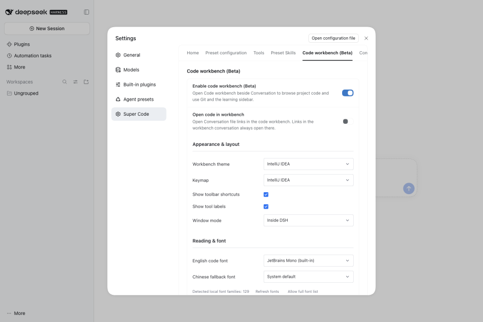
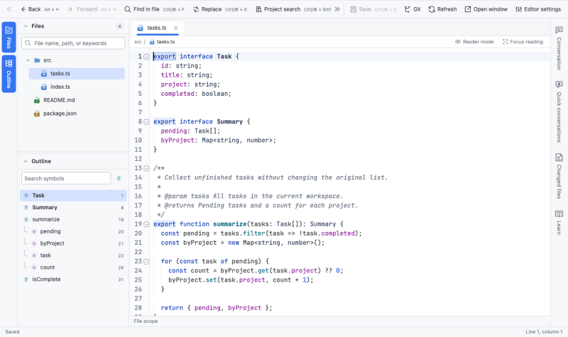
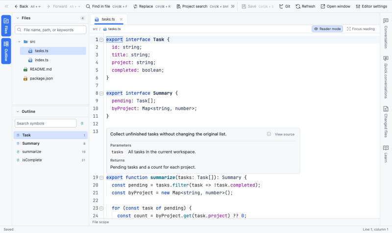

# Code workbench

[中文](../CodeWorkbench.md) · English

## Enable and open the workbench

1. Open **Settings → Super Code → Code workbench**.
2. Turn on **Enable code workbench (Beta)**, the first switch shown below. It is off by default, takes effect immediately, and is saved in this client. Toggling it does not initialize a project or change its preset.

[](../images/workbench-settings-en.png)

3. Return to a conversation with a working directory. Open **Code workbench** beside **Conversation**, then select a file in the left-hand tree.

[](../images/workbench-en.png)

- **Files** browses the project; **Outline** jumps to declarations in the current file. Each can be collapsed independently.
- Edit in the center, then click **Save** or press Ctrl/⌘+S to write changes. The current conversation's access permissions apply.
- Use **Git**, **Open window**, or **Editor settings** in the top toolbar. The right rail opens Conversation, Quick conversations, Changed files and Learn as needed; the example shows the current conversation alongside the code.

The second switch, **Open code in workbench**, controls file links in the main Conversation tab. Enable it if those links should open in the workbench. It is also off by default and is separate from the main workbench switch.

Workbench overviews, settings and tool-profile screenshots show an isolated Harness instance with a demo project and sample conversation; the reader image shows the same workbench component. Click an image for the full-size version.

## Reading and navigation

After reloading the page or reopening the client, choose **Continue previous work** on the empty workspace to restore file tabs, pinned files, editor splits and their proportions, the active pane, cursor positions and source scroll positions. Recent files are also retained. Restoration starts when you choose it; opening another file does not jump back to an old location. Records are kept separately for each client, conversation and project directory. Navigation in a separate window does not overwrite the main workspace record.

During restoration, choose **Stop** or open another file. Files that have already opened remain available.

Restoration reads current file contents. Moved, deleted or unreadable files are listed with their errors while the other files open. Records contain interface state, not unsaved text, quick conversations or learning content. Save unsaved text before exiting. If browser storage is unavailable, a notice offers a retry while editing remains available. Each record supports up to 16 panes and 50 tabs per pane; exceeding the storage limit keeps the previous record and shows a notice. The empty workspace also offers **Open file**.

Choose **Open file**, or press Ctrl/⌘+Shift+O with the IDEA keymap or Ctrl/⌘+P with VS Code. An empty query lists recently visited files first; matching names include their relative paths. Type `@` to find a symbol in the current file or `>` to search actions. Arrow keys select, Enter opens, and Esc returns to the editor. Enter during IME composition only confirms input. IDEA keeps Ctrl/⌘+P for parameter info. Ctrl/⌘+Shift+P opens All actions; Ctrl/⌘+Shift+Enter toggles reading focus. Existing custom bindings take priority over new default shortcuts; buttons remain available and shortcuts can be reassigned in settings.

The default toolbar shows Back, Forward, Open file, Find and project Search. Replace, definitions, completion, parameter info and code history are available through All actions and can be restored to the toolbar in settings. New layouts use a 200px explorer and 320px right sidebar, keeping more room for code in narrow windows. Saved dimensions, pane visibility, action order and visibility are preserved.

Code defaults to bundled JetBrains Mono at 14px with 1.5 line spacing. The variable regular and italic faces support weights 100–800 and work offline. In **Reading & font** in either editor settings or Super Code settings, choose the English code font and Chinese fallback font separately, and adjust size and spacing. Chinese defaults to system fallback; existing font choices are preserved. Preferences save immediately and synchronize across this client's sessions and detached windows; changing autosave, model, or toolbar settings preserves the current documentation and keyboard focus.

Opening settings detects available local font families; **Refresh fonts** scans again. Browsers that support full font enumeration offer an authorization button. Other environments check system candidates on the current client, so a remote server's fonts are not assumed to exist locally; the list may be incomplete. Saved fonts that are not detected remain selectable with a fallback notice. Detection neither installs fonts nor reads project files.

**Reader mode** is off by default. Toggle it beside the current file path. It adds 1px to the code font size and uses line spacing of at least 1.65 times that size, rounded to whole pixels. Documentation shares the code line height. Comments appear upright with stronger contrast, and long lines wrap to the editor width. Source line numbers, text, selections, and undo history are preserved. Turning the mode off restores horizontal scrolling. Git comparisons keep their line alignment.

[](../images/workbench-reader-en.png)

Standalone multiline `/** … */` comments and initial Python module, class, and function docstrings follow their source indentation and show their original starting line. When space is tight, longer blocks show a summary first. Choose **Expand documentation** for the full description, parameters, return values, and examples. Wider views open blocks in full by default. IDEA uses an inset card with a boxed control, and VS Code uses the editor background, a thin rule, and a chevron. **View source**, a search match, or a selection entering the block restores the original comment for editing, questions, and undo. Formatting is limited to documentation in view. Very long blocks remain virtual source lines.

The IDEA reader draws a thin divider before adjacent function, method, and type declarations when there is no blank line or documentation between them. The VS Code reader cycles through three colors for parsed round, square, and curly bracket pairs. The two ends of a pair share a color, and ordinary bracket characters in strings and comments keep their syntax color. Token-only language modes keep their usual highlighting.

As a multiline signature scrolls out of view, its sticky heading shows the part that has passed above the editor. The remaining parameters stay visible on their source lines. Hover over a heading for the full signature. The mouse wheel still scrolls the code while pointing at a sticky heading. IDEA shows boxed folding controls beside the pinned line numbers. VS Code reveals chevrons on hover or keyboard focus. Click a folding placeholder or focus it and press Enter to expand the code. When Reader Mode follows the viewport, the active indent guide follows the code block you are reading.

In a narrow workbench, the sidebars shrink to give the editor room. Use **Focus reading** beside the file path to hide the current window's sidebars and tool strips while keeping the file tabs and editor actions available. Toggle it again to restore the panels and their sizes. Focus reading works alongside Reader mode and is controlled separately in each full workbench window.

With sticky scroll enabled, the editor keeps up to three enclosing declarations in view. Multiline signatures fit on one row. Their beginnings stay visible while the code scrolls horizontally. Click a heading to jump to its first line, then use Back or Forward to navigate. When a single caret with no selection is offscreen, Back returns to the passage you were reading.

Indentation guides reflect spaces and tabs on visible lines. The current block's guide is stronger, including on blank lines inside the block. IDEA shows enclosing classes and functions at the bottom. VS Code shows them in the top breadcrumb. In a narrow editor, the reading buttons keep their icons and tooltips to leave room for the current symbol. In Reader mode, scrolling a single caret out of view makes the breadcrumb and outline follow the visible code. IDEA labels the reading position at the bottom, and VS Code marks it with an icon and an underline in the breadcrumb. This works with sticky scroll disabled. While text is selected, the editor continues to show the caret's scope. Click a name to visit its declaration and use Back to return to the passage. Each window follows its own viewport using the current file's syntax tree.

Method calls use function colors while ordinary properties retain property colors. The IDEA theme uses a divided gutter, stronger type and function declarations, boxed folding controls and rounded documentation blocks. Long lines with indentation guides add two columns to their continuation indent. The VS Code theme uses an outlined current line, folding chevrons that brighten on hover and a side rule beside documentation. Its continuation lines align to the source indentation. The outline uses each theme’s type icon for declarations confirmed by the syntax tree. Both themes follow the host’s light or dark appearance. In narrow editors, documentation uses a single column and continuation indentation is capped to fit.

The outline, definitions, and usages share one declaration index. JS/TS assignments and increments are usages rather than new declarations; explicit loop bindings remain available. Python and PHP list the first assignment per scope without duplicating parameter or declared external bindings when written again. Go retains every name in a multi-variable declaration and distinguishes existing bindings from new names in a short declaration. Same-name declarations in separate scopes remain distinct rather than being merged by name.

The outline indents declarations under their enclosing types or functions. The IDEA palette uses round method icons and elbow guides. The VS Code palette uses line icons and compact vertical guides. While browsing in reader mode, the outline hides confirmed local variables. Search can still find them. Unparsed code and languages with lexical highlighting retain their symbols.

Search the outline by name or enable **Functions only**. Results show their enclosing type or function. Use `ClassName.methodName` to distinguish declarations with the same name. Search ignores case and surrounding whitespace, retaining source order and same-name declarations at different locations. Arrow functions, anonymous functions and lambdas directly bound to variables are classified as functions too. In the search field, use Up/Down to select and Enter to visit; Esc clears the query, then returns focus to the editor. Switching files resets the query and filter. The main page and detached windows keep independent search state. Long lists render only visible rows; searching neither reads project files nor calls a model.

Without a search query, a thin left border marks the current class or function. The keyboard candidate has its own highlight. Searching preserves the candidate and input focus. The outline keeps its scroll position until parsing and the declaration index reach the current location.

Placing the cursor in a word highlights matching whole words in visible code, with a thin outline around the cursor's word. Manual selections can match substrings. When reader mode follows the viewport, matches from an offscreen caret temporarily disappear. The find bar uses warm result highlights with an outline for the active match. The selection and caret keep their source positions.

Inside a function call's parentheses, press Ctrl/⌘+P with the IDEA keymap or Ctrl/⌘+Shift+Space with the VS Code keymap to open **Parameter info**. Find it in **All actions** in the toolbar, or configure a custom shortcut. The compact popup shows project signatures, types and the current parameter's description, emphasizing that parameter; hover over the function name for full documentation. It follows cursor movement within the call, switches to nested calls, and closes on Esc, leaving the call or switching files. It uses the existing same-name candidate index and matches named arguments by name. Spread arguments and implicit receivers retain the full signature when a reliable mapping is unavailable. No model is called.

**Keep scope headers while scrolling** is on by default. Up to three parent declarations stay visible, and clicking a header returns to its source line. It uses the existing language syntax tree without another project index. Plain text and legacy token-only language modes do not infer scopes. Git comparisons retain a fixed line height for alignment.

The workbench is independent of the selected preset. Official, Super Code and third-party preset sessions use the same entry, current workspace, model and access permissions. File buttons, links and icons in the right-hand conversation follow its compact text size while retaining the host's file detection and navigation.

Place the cursor inside a function and choose **All actions → Code history** in the toolbar to trace its changes backwards. An explicit selection takes priority; languages without function parsing use the current line. This query is not limited to the latest 30 commits. It follows parents reachable from the current HEAD, including merges, file renames, renamed functions and identifiable code moves. Native and built-in Git share the range-tracking algorithm. The virtualized list follows commit ancestry; selecting an entry loads its before/after code with original line numbers.

Unsaved selections are mapped to their committed predecessor; newly written code may have no committed history. Shallow history, ambiguous sources, replacements spanning adjacent code and unsupported historical text are marked as incomplete. Queries can be stopped, retried or refreshed. Refresh uses the code snapshot captured when the dialog opened; reopen Code history after editing the selection. Queries are read-only, use no model and create no disk index. Existing text-diff size limits apply.

Conversation file links opened through **Open code in workbench** locate the referenced line. File links in the workbench conversation always open in the current workbench using the host’s path recognition, regardless of this switch. Disabling the workbench restores the host’s original file preview.

Opening a file does not wait for the project index. Indexing continues in the background while files remain available for reading, editing, and navigation.

Mouse Back/Forward buttons and toolbar navigation restore cursor positions within and across files. Drag selection and continuous typing do not create per-character history. Each editor pane and separate window keeps its own navigation history.

Project search displays matches while scanning and renders only visible result rows. Versioned filters skip files that cannot match; short queries, Unicode queries and files without reliable versions still use complete reads. Rebuildable metadata uses the project background cache described below, without storing source text or unsaved buffers.

The right sidebar initially shows journaled messages and tool records from the current conversation, with a short transition that respects reduced-motion preferences. Its text input shares the host draft and submits through public host input actions, keeping the same session, prompt, and model. Consecutive tool records collapse into tool names and success/failure counts; zero-count badges are omitted, and expanding shows original calls and results. The question bar navigates questions in the loaded window, and **Back to bottom** resumes following new messages; older records remain paginated. Conversation and Changed files collapse independently, with Changed files initially collapsed. Token streaming, approvals, and reference or attachment operations remain in the full **Conversation** page; the original draft is preserved. Messages reuse the plugin's existing renderer rather than reproducing the complete host chat interface. Hosts without public input actions offer a return-to-conversation link.

The left vertical rail offers **Files** and **Outline**; the right offers **Conversation**, **Quick conversations**, **Changed files**, and **Learn**. Each entry expands or collapses independently. Collapsing every entry on one side gives its space to the editor. Learn is initially collapsed and can remain open alongside Conversation. Toggling it makes no model request and preserves reading goals, conversation drafts, files, selections, and unsaved edits. Drag the dividers to resize the explorer and right sidebar or adjust the height between Files and Outline. Dimensions and left collapse states are remembered; focused dividers also support arrow keys. The outer host composer is hidden. IDEA and VS Code styles cover code, explorer, toolbar, popups, and learning, following the host light or dark theme.

Expand adjacent Conversation, Quick conversations, Changed files, or Learn panes to drag their shared height divider. Arrow keys and Home/End also resize them. Collapsing a section gives its space to the others; proportions are remembered in the current client. Common toolbar actions stay on one line; search **All actions** for the others. Toolbars with more custom buttons still scroll horizontally.

The themes follow the open-source UI conventions of [IntelliJ IDEA New UI](https://github.com/JetBrains/intellij-community/tree/master/platform/platform-resources/src/themes/expUI) and [VS Code Modern](https://github.com/microsoft/vscode/tree/main/extensions/theme-defaults/themes). IDEA uses compact tool-window stripes, rounded selection rows, and a bottom tab indicator. Vertical labels appear below icons on both side rails by default. Turn off **Editor settings → Appearance & layout → Show tool labels** to hide them; the same switch is available in Super Code mode settings and takes effect immediately. VS Code uses activity bars, square lists, and a top tab indicator. Rail icons show their names on hover; the explorer, search, Git, selection dialogs, and window controls follow the selected theme.

The active file tab stays visible when switching files or narrowing the workbench. Selection questions open below the selected code when space allows, or above the selection otherwise.

Editor settings are grouped into Appearance & layout, Reading & font, Files & editing, Language environments, Quick chat & translation, Quick actions, and Custom shortcuts. The navigation scrolls to each group and becomes horizontal in narrow windows. Settings continue to save immediately and synchronize across conversations in the same client.

Search settings by name or keyword at the top. All entered words must match; matching text is highlighted. Enable **Modified only** to show settings that differ from defaults, or **Clear filters** to return to the full list. The **Reset** button beside a setting restores that item. Resetting a model keeps its thinking effort, resetting quick action order keeps button visibility, and resetting a language path clears only that language’s manual path. Global Super Code settings provide the same search and individual reset controls. Failed saves preserve the saved values and show an error so you can retry.

Under **Editor settings → Quick actions**, choose which actions to show and reorder them with the up/down buttons. Changes apply immediately, persist in the current client, and can be reset. Scroll with the mouse wheel or trackpad over the toolbar, or use the double-chevron buttons. The fixed order on the right is Save, Git, Refresh, Open window (Return to DSH in the external window), Editor settings, and All actions. These actions cannot be hidden or reordered. Narrow windows collapse their labels; names remain available on hover. Hiding an action leaves its keyboard shortcut available.

In **Editor settings**, **Show toolbar shortcuts** is off by default. Shortcuts remain in hover hints and All actions; enable the setting to show them beside toolbar labels. Saved settings are preserved. **Window mode** defaults to **Inside DSH**; choose **Separate window** for subsequently opened settings, search, Git, file-action, and selection dialogs. Returning to DSH or a failed launch does not automatically reopen the window.

Dialogs support dragging, resizing, minimizing, keeping on top within the page, and maximizing within the page. The top-right close button has a larger click target. Esc closes the topmost dialog, with confirmation dialogs and menus handled first. Change this key under **Editor settings → Custom shortcuts → Close dialog**.

The toolbar **Open window** opens the full workbench. Dragging a file tab out opens only that file (or its Markdown preview). Search, Replace in project, Git, file actions and selection dialogs also offer **Open window** at the top right, showing the corresponding tool and retaining queries and drafts. Separate windows use system move, resize and minimize controls. The web app first uses a browser window; desktop hosts use macOS WKWebView, Windows WebView2, or Linux WebKitGTK without copying Electron. The main page and multiple separate windows remain usable together. Each keeps its own current file while sharing buffers, save queues, undo history, selection-question drafts, and one source index. The main conversation stays in DSH. **Return to DSH** or a normal close affects only that window. Missing components, loading timeouts, and unexpected exits leave the embedded content available without installing system components. Closing the host page or losing the connection stops operations in the separate window; unconfirmed code text and question drafts remain available to copy.

File-comparison targets, Git file selections, and commit-file lists stay synchronized across tool windows; an older read cannot restore a replaced target. Conflict reloads preserve drafts edited in another window while loading. Saving a resolution saves the content at click time. If newer edits arrive, the draft stays open with a notice; copy anything to keep before reloading. A successful commit clears only the message used for that commit, preserving a newer message entered during the operation.

Changing a tool's file or query hides read errors for the previous target. Completing staging, a commit, or hunk restoration preserves later file selections in other windows. Function history keeps its current list when window synchronization sends unchanged content; diff editors preserve search, selection, and scroll position as well.

Repeated replacement previews use the latest scan, even with identical search conditions. An earlier replacement updates only its own preview, preserving any newer preview. Incomplete or failed new scans cannot be applied.

An uninitialized separate window can close immediately. Navigating to another file in the main page leaves separate windows on their own files; edits to the same file synchronize. Closing one window leaves the others open. Late errors from a closed window cannot close a newly opened one. Switching projects stops selection requests from the previous project; late replies cannot modify same-named files in the new project. After a file creation or undo succeeds, a later read or folder-refresh failure is reported separately without asking you to repeat the completed file action.

**Follow the current file in the tree** and **Open files in preview tabs** are enabled by default in Editor settings. Following expands parent folders and scrolls the virtual list to the file. Manually expanding another folder preserves your browsing position until the active file changes; turning the setting off stops automatic navigation. An italic preview tab is replaced by the next unopened file until edited, double-clicked, reordered or pinned. Disabling preview tabs retains newly opened files as regular tabs.

Switching open source tabs preserves each file's vertical and horizontal reading position, selection, and folds, including after remounting or reopening a closed tab. Definition, search-result, Back, and Forward navigation still reveal the target code. The main page and separate windows remember positions independently in memory. If a file changes while inactive in a separate window, reopening uses its latest text and selection.

Replacing a preview releases clean buffers that no other view uses. Unsaved content, pinned files, and selection conversations remain available. Releasing a buffer does not delete undo history; history navigation rereads the file and restores its location. Separate windows also retain host text updates, selections, and versions during initialization, language loading, and remounting.

Opening another file or using Back or Forward cancels an earlier file read or language initialization. The editor uses the latest shared content when loading finishes, preserving edits and selection conversations from other windows. Failed initialization leaves no unopened file tab. Switching projects clears the previous directory listing, file clipboard, and operation panel.

Rail entries and pane headers control the same expanded state. Closed entries leave no collapsed header. Learn does not replace Conversation. All six pane switches, sidebar widths, and height proportions are remembered in the current client and synchronized live between DSH and full separate windows. Opening a window does not reopen collapsed panes. File-only and tool-only windows still show only their focused content. Conversation tables, file links and long text wrap inside the sidebar; code blocks scroll horizontally on their own.

For Markdown files, choose **Edit and preview** in the path bar to edit on the left and see your unsaved changes on the right. **Rendered preview** opens a preview tab, and **View source** returns to editing. Project paths are resolved relative to the document first, then from the project root. Paths with `./` or `../` are relative to the document. File links open in the workbench and directory links reveal the file tree. Separate windows support the same preview and project links.

Browse the current conversation's working directory on the left. Right-click a file or folder to create files/folders, copy and paste, copy relative/absolute paths, or move to system trash. The empty-area menu targets the working directory. File references stay within the current workbench. Paste allows a new name and never overwrites an existing destination. Pin files to the start of the tab bar; tabs also have a context menu to unpin. File-type icons use colors. **Editor settings → Workbench theme** selects IDEA or VS Code colors independently of keymaps.

Right-click a file tab for **Split right**, **Split down**, or **Open in separate window**. Drag a tab to a highlighted editor edge to split, into another group to move it, or out of the workbench to open a separate file window. Drag the divider to resize. Each group keeps its own tabs, selection, scroll position, and navigation history. Views of the same file share edits, save, and undo. Tabs within a group can still be reordered among other pinned or regular tabs.

Close tabs with their close button, middle-click, or context menu. Closing the active tab selects a neighbor, and empty groups collapse. Unsaved files offer **Save and close**, **Keep edits and close**, or cancel. Kept edits and undo history can be reopened during the current client lifetime, and configured auto-save continues.

The tab menu also offers **Close other tabs**, **Close tabs to the right**, and **Close saved tabs**. These keep pinned tabs. Bulk closing prompts for each unsaved file; cancel stops the remaining closes. Files with the same name show a distinguishing directory beside the name. **Reopen closed tab** or `Ctrl/⌘+Shift+T` restores up to 20 recently closed tabs, newest first. After closing all tabs, find the command in **All actions**. Tabs from collapsed groups reopen in the current group; preview replacement and moving tabs do not enter the history. History stays in memory for the current workbench, with separate histories for separate windows, and does not survive exiting the app.

File actions respect the session access mode. Save unsaved edits before moving files to trash; editing pauses during that operation. If system trash is unavailable, an explicit error is shown instead of permanently deleting. Linux needs gio or trash-put. Failed folder copies retain partial destinations and report that they need checking before retrying. File actions, undo, and redo can be cancelled before writing begins. Once writing starts, the current action and its undo record are completed together so a changed file does not lose its recovery entry.

Creating, copying, trashing, undoing, or redoing files in the workbench updates loaded directories and file-name searches in other windows of the same project without changing unsaved edits. Restored folders whose contents have not been loaded appear collapsed and can be read again with one click. Trashing an entry cancels pending opens only for that entry and its descendants, leaving unrelated navigation running. Back and forward controls update with navigation history. Open Git panels in the same project refresh after saves, project replacements, and Git writes. Failed or cancelled writes may have already changed the repository, so its actual state is read again. Hunk restores, conflict saves, branch switches, pulls, merges and merge aborts synchronize loaded files even if the Git panel has closed. Late results from the previous project do not change the new project's text or error state.

Edits initially stay in buffers until **Save** or Ctrl/⌘+S. **Editor settings → Auto save** also offers saving on every change, or after 15, 30, or 60 seconds idle. Timers survive switching files and conversations. Auto-save waits for an active file operation and continues after it finishes. Saves retain access-policy and file-version checks; failures keep the buffer without overwriting external changes.

When saving detects a changed disk version, choose **Compare and merge** in the status bar. The left column preserves the draft, the right shows the latest disk content, and the center is editable. Expand the original content when needed. Non-overlapping changes merge in the preview; overlapping changes require editing or explicitly choosing an entire side. Cancel leaves the editor draft intact, and text on either side can be selected and copied.

**Apply to editor** checks the disk and draft again before updating the shared buffer. A stale result is kept for review and can be compared again. Applying is undoable and does not write or stage the file; review and save afterward. Auto-save also waits for review until you save manually or continue editing. Comparing again asks before replacing the current result. Separate windows use the same version checks.

Queued saves, undo, replacement, and Git file switching check their originating directory. Switching directories cancels pending operations instead of applying them to the new project; unsaved content remains in the original project. Completed saves and replacements update only their original project.

**Maximum undo steps** defaults to 1000 per conversation. Conversations in a project share file buffers, while keeping their own modification histories until the client closes or the plugin unloads. Undo and redo cover typing, assistant edits, replacements, creation, copies, and trash. Host-side temporary recovery copies stay outside projects and are released when history expires or the plugin unloads. Restoration never overwrites an existing destination. Overlapping external edits produce a conflict message; undo in other files remains available, and non-overlapping changes in the same file are preserved where possible. Undoing a file action does not automatically save another conversation's unsaved edits.

Ctrl/⌘+F opens file search. The IDEA theme uses a full-width bar and the VS Code theme uses a compact bar aligned to the right. Results update after typing, pasting, or committing an input method composition. Press Enter or Shift+Enter to move between matches and Esc to return to the source. Ordinary text searches show the result count and current position, with `1000+` for dense results. Large files and regular expressions support highlighting and navigation with the count omitted.

Ctrl/⌘+R expands file replacement. Ctrl/⌘+Shift+R opens project replacement. Choose **Preview matches**, check the files to change, then choose a file name to compare its complete contents before and after replacement. The diff arrows move between changes. Reviewing a diff does not write the file. **Replace in N files** writes only checked files and records undo history for each successful replacement. Checked files and the file under review stay synchronized between embedded and separate windows; Tab, Space and Enter are supported.

Project replacement walks editable text independently, excluding dependency and build folders. Binary files and files over 2 MiB are counted as skipped. Unsaved files, stale versions and write failures are reported individually. Stopping cancels subsequent files. Successful files leave the pending list and remain undoable; unfinished and unchecked files stay available. **Recheck remaining files** reads their latest versions for another review without adding successful files back. A failed or stopped recheck preserves the previous scope and selection. Original CRLF or LF line endings are preserved.

Closing the separate project replacement window also stops subsequent files. Successfully written files still leave the pending list, so you can continue with the remaining files from the main page.

Changing the search text, replacement text or case setting in any window invalidates the previous preview. **Preview matches** starts a new scan of the whole project.

Toolbar actions display names, with configured shortcuts in hover hints. IDEA and VS Code themes also distinguish icon shapes, fonts, corners, selections, and syntax colors. Gutter spacing and conversation text are more compact. The whole Changed files heading toggles its panel, with centered graphic arrows.

The search box below **Files** matches file names and relative paths, including spaces and Unicode, without case sensitivity. Separate keywords with spaces, such as `src controller`, to match directory and file names together. Exact file names, name prefixes, and name substrings precede path-only matches, preserving original order within each group. It lists directory entries without reading file contents and is independent of source-index extension and individual file-size limits. Both the tree and search results use virtual scrolling, rendering only visible rows.

Use Up/Down to select and Enter to open the current candidate. Home/End move to the first/last result when the list is focused, retaining normal text-cursor movement in the input. The candidate scrolls into view and remains selected as scanning adds results. The main page and detached windows keep independent searches and selections. Clear the query or press Esc to restore the original tree and keep input focus. Refresh files and index to update the file list. Directory access failures or truncated host listings are reported as incomplete results.

Common languages have syntax highlighting, keyword and primitive-type suggestions, and project-symbol completion. Hover over functions for source signatures and adjacent documentation; text inside comments does not show usage popups. Ctrl/⌘+click a call for definitions, or a definition for usages. Use toolbar navigation or mouse side buttons to move backward and forward. Ctrl/⌘+F searches the current file; Ctrl/⌘+Shift+F searches the project. Tab and Shift+Tab indent and outdent; Ctrl/⌘+/ toggles line comments. **Editor settings** offers independent IDEA and VS Code palettes and keymaps, plus custom shortcuts.

**Editor settings → Language environments** provides automatic source-directory detection and a manual environment or source path for Python, JavaScript / TypeScript, Go, Rust, Java, C / C++, C#, PHP and Ruby. Clearing the path restores detection. It reads project `.vscode` settings, explicit interpreter or SDK paths in `.idea`, and project environments and dependencies. An IDEA SDK name without a path cannot be resolved automatically. Remote paths are read through the host file service on the corresponding machine.

When a definition is missing from the project, explicit imports can resolve to dependency sources. Python packages and JS/TS declarations follow relative re-exports; other supported languages use import names and source-directory layouts. Sources open read-only and do not enter the persistent project index. Detection never runs interpreters, compilers or project scripts, installs environments, or modifies IDE settings. This is not full type inference or package-manager resolution. Binary-only symbols, source archives, conditional exports and complex package mappings may not resolve; extracted source directories can be configured manually. Each source file retains the 2 MiB text limit and host access restrictions.

YAML, YML and TOML use bundled syntax parsers. Markdown previews color language-labelled code blocks using the workbench theme; unknown languages remain plain text. Conversation sidebar text and code blocks wrap while retaining indentation and explicit newlines. Empty definition results show a centered explanation and a language-environment settings hint.

Project search and replacement share the query, case, whole-word and regular-expression options, and **Search scope**. Expand the scope to enter a project-relative directory or choose **Current file directory**, then add include/exclude rules. The active scope remains visible when collapsed. Separate rules with commas: `*.ts` matches TypeScript files at any depth, `src/**` selects the root src directory, and `**/*.test.ts` matches test files at any depth. `?` matches one character. Built-in dependency, build-output and virtual-environment exclusions still apply. Changing the scope or matching options invalidates the replacement preview and requires a new preview.

Matching is case-insensitive by default. Whole-word boundaries use Unicode letters, numbers, combining marks, `_` and `$`. Regular expressions use JavaScript syntax with line anchors; replacements support `$1`, `$<name>`, `$&` and `$$`. With regex disabled, dollar signs in replacement text stay literal. Invalid expressions show an error and can be corrected. Tool windows share the query with their source page; full standalone workbenches inherit the initial query and then keep independent queries.

Project search, definition, and usage results support Up/Down to select and Enter to open the chosen file and location. Home/End move to the first/last result when the list has focus; in the search field they still move the text cursor. Selected results scroll into view while large lists render only visible rows. Changed queries, loading, and failed searches cannot open stale results. DSH and standalone windows share the query but keep their selections independently. Navigation from a standalone tool window opens the result in the original workbench.

Hover signatures follow the current code theme, English/Chinese font choices, and editor or reader-mode size. Descriptions, parameters, and return values support Markdown paragraphs, lists, inline code, and tables; long parameter names wrap in narrow windows. Documentation cannot load images or execute scripts and unsafe links. This formats existing documentation without generating types or explanations or changing source comments.

IDEA defaults include Ctrl+Alt+Up/Down to add cursors, Alt+J to select the next occurrence, and Ctrl+Alt+Shift+J to select all occurrences. Ctrl+Left/Right extends the selection by a word. Multiple cursors edit together; Esc returns to one cursor, after cancelling any pending completion. These actions support custom bindings.

**Super Code mode → Code workbench** also provides common theme, file behavior, window mode, auto-save, and undo settings. It shares the same client preferences as **Editor settings**, and updates other conversations in that client immediately. Shortcut recording and toolbar ordering remain in Editor settings.

Select code, choose **Ask / Edit**, enter a request, and send. The assistant uses the current conversation's selected model and requests thinking off by default. If its DSH configuration does not offer an off option, the settings explain that configuration or another model is needed; other thinking levels are never silently substituted. Choose a separate quick-conversation model and thinking level under **Super Code mode → Code workbench** or **Editor settings**; both entries share the same settings, and changes apply on the next send without changing the main conversation. The bubble and quick-conversation list show answering, completed, stopped, or failed status. It receives the file buffer, selection, request, and that bubble's history, with no main-conversation history or tools. An edit replaces only the selection and can be undone; saving writes it to disk. Changed selections, interrupted requests, and incomplete model responses are not applied.

An unsent draft creates no marker. Empty temporary questions are cleared when leaving their selection; typed drafts are kept. Sending or pinning creates a circle beside the selection. Click it to reopen the conversation; the bubble offers pin, unpin, and delete. Deleting cancels an active request. Markers and bubble history remain only for the current plugin lifecycle and are not written into the project.

**Quick conversations** on the right is initially collapsed and shows a count. Expand it for sent or pinned selection conversations across sessions in the same project, with file locations. Click the preview to reopen the original conversation or the file location to navigate to source. The list and editor markers share the same records, which are not retained after the application closes.

Select code or comments and choose **Translate to current language** to translate into the window language. The first request contains only a simple translation instruction with the selected text, without source context, main-session history, tools, or a system prompt. Follow up in the separate translation bubble. Translation defaults to the current conversation model with thinking off. Choose its model and thinking level independently in the same settings page, without changing quick conversations or the main conversation. Unsupported levels produce an error; low reasoning never substitutes for off.

Navigation prioritizes lexical bindings and parameters in their owning function. Explicit project imports in JS/TS and Python resolve through their source and aliases. Same-name candidates use compact rows with expandable documentation. Full type inference, package-manager module resolution and exact overload analysis remain unsupported. JS/TS, Python, Go, Rust, C/C++, Java, and PHP use syntax trees; C#, Kotlin, Swift, Ruby, and Shell use token highlighting and declaration rules. Types and documentation come from source, without invented types. Project indexing has no fixed file-count, directory-count or total-text limit. Individual editable text files remain limited to 2 MiB. Dependency and build directories are skipped; unreadable text is reported.

Project search and replacement use the same text scan, including plain-text and extensionless files, independently of source-index coverage or readiness. Search prefers unsaved buffers shared by sessions in the same project; replacement still checks disk versions and rejects unsaved files. Locations arrive in batches and results use virtual scrolling, without the previous 500-result cap. Binary files and files over 2 MiB are counted as skipped. Both scans exclude the same dependency, build, and Python-environment directories. Search can update rebuildable metadata in the project background cache without modifying source files.

Source indexing runs in a background worker, reusing each language parser. Declaration locations and text filters stay resident, and identical content shares analysis metadata. Source text and detailed references use a 16 MiB cache budget based on estimated sizes; eviction never removes indexed files. Declaration metadata still grows with project size, so this budget is not a process-wide memory limit. Search, usages and documentation load content on demand, with virtualized results. Separate windows query the original page instead of copying the project index. Leaving the workbench releases the in-memory index; reopening restores version-matched project metadata and analyzes remaining files without discarding edit buffers or undo history. Editing retains CodeMirror's chunked document instead of copying the full text on every keystroke. Saving Windows files preserves CRLF line endings.

Usage queries for ASCII names of three or more characters can skip unrelated files even when their comments or strings contain non-ASCII text. Short and non-ASCII names follow the existing lookup rules.

While unchanged source remains cached, repeated documentation, parameter-info, and definition queries reuse the existing index without recomputing the full-source fingerprint. Pages without WebCrypto also retain their parsed results. Evicted or changed text still updates on demand.

Concurrent documentation, parameter information, and definition requests for the same source share one pending detailed analysis, including requests from separate windows. Cancelling one request does not cancel the others. Pending work is released on success or failure; results still follow the existing cache budget without retaining another source copy.

Documentation for many same-name candidates looks up existing declaration positions instead of rescanning the whole file for each result. Signatures, documentation, sources, and candidate order remain intact, without another resident index. Parameter information parses JS/TS methods, generic methods, and constructors in method context, then highlights the current parameter in the original signature.

Declaration-name lookup stops at the first valid position instead of repeatedly walking large interfaces or initializer expressions. Existing language rules and declaration coverage remain intact. While a declaration is incomplete, empty names inserted by the parser stay out of the outline and completion results.

When one line contains several independent variable declarations or assignments, source descriptions use each declaration's syntax-tree range instead of repeating the surrounding line in every signature. Source types and existing header rules are preserved. Multiple bindings in one declaration retain their shared declaration; legacy token modes still use source lines.

Initial or recomputed project completion reads declaration positions from the existing name index instead of rescanning the file for every candidate. Candidates are not capped; the current file still takes priority, and exact queries retain every same-name definition. Name metadata grows with project size. Continued typing reuses the editor's existing completion-list mechanism.

Choose **Git** in the toolbar to manage the repository in the current conversation's working directory. Native Git is preferred; the bundled engine is used only when Git is unavailable. The panel identifies the active engine. Opening it does not initialize a repository; initialization requires confirmation. Native Git respects existing hooks and authentication configuration. Failed operations are never replayed through another engine. Status, diffs, and line statistics use temporary memory caches without creating another disk index or refreshing the real staging index. Explicit staging, commits, and network operations still update normal Git data.

Right-click a file and choose **Compare** to search for another project file or enter its relative path. File extensions need not match. Open files use shared unsaved buffers when available. Comparing does not write files or navigate away from the current editor, and can continue in a separate window.

**Working copy** separates staged and unstaged files. Select a file for a side-by-side comparison, synchronized scrolling, and previous/next-change navigation, or open it in the editor. Stage or unstage individual files or all listed files. Confirmation shows all staged files before committing. Session and Agent filters use successful file operations in loaded conversations. These links indicate related operations, not line-by-line authorship; arbitrary shell changes are not attributed.

Use the right arrow next to a changed block to restore only that block. In **Staged**, it changes only the staging index, preserving working files. In **Unstaged**, it restores working text from the index. The **Changed files** sidebar restores working text from HEAD without changing the index. Unsaved target files, stale repository versions and read-only sessions are protected. Ordinary file comparisons and history remain read-only. If Git finishes but the file view cannot refresh, the separate error lets you refresh without repeating the write.

Both the Super Code sidebar and the workbench's right sidebar show **Changed files**, initially collapsed, with the repository's changed-file count, file-name or relative-path search, source filters, and added/removed lines when expanded. Counts compare HEAD with disk content. Binary files are identified separately; an ellipsis indicates files beyond the statistics limit. Only visible files are analyzed, and both lists share state. Foreground Git operations interrupt background line statistics, which resume afterward. Select a file for a side-by-side comparison, with an editor shortcut when the workbench is open. Unattributed changes remain visible and are not assigned to the current Agent.

**History** shows the latest 30 commits and their changed files and comparisons. **Branches** supports creating, switching, deleting merged branches, and merging local or fetched remote branches into the current branch. Native Git uses its own merge capabilities. The bundled engine supports fast-forward and common three-way merges, with explicit errors for unsupported merges. Handle unsaved edits and uncommitted changes before switching, merging, or pulling.

Select a conflicted file for three-way resolution: the current version on the left, incoming version on the right, and an editable final result in the middle. Accept individual blocks or an entire side. Saving is disabled while complete conflict markers remain. **Save and mark resolved** writes and stages only that file; committing the merge remains explicit. External changes preserve the draft and prevent overwriting; **Discard draft and reload** obtains the latest repository state. Drafts survive moving between embedded and separate windows. Only regular text files are supported; binary files and symbolic links report an explicit error. The bundled engine handles ordinary merge conflicts; other merge types require native Git.

**Remotes** supports URL configuration, fetch, fast-forward-only pull, and normal push, without force push. The bundled engine supports HTTP(S); native Git also supports SSH. Credentials must not be embedded in URLs. Native Git defaults to existing credential helpers, SSH keys, and agents; **Use other credentials** enables optional overrides. The bundled engine cannot call native credential helpers and needs manual credentials. Entered passwords or tokens stay in memory and are cleared when returning to system credentials, leaving the remote tab, or closing the window. Pull and push confirmation identifies the branch and remote URL.

The session working directory must be the repository root on a locally accessible filesystem. Read-only sessions can inspect state and diffs. In restricted sessions, all native Git commands use the host command sandbox, including reads that may execute repository-configured filters. The bundled engine does not support linked worktrees or `.git` files/symlinks; use native Git for those layouts. Changed-file lists, commit-file lists, and batch staging have no file-count cap; the lists use virtual scrolling. Text comparisons are limited to 2 MiB per side and 20,000 lines total.

If the conversation's working directory is removed or becomes a file, a recovery dialog offers registered directories and a directory picker. Confirmation creates a continuation with completed history, the preset, model, and access mode, since the original session header cannot be rewritten. The original conversation and any unfinished content are kept. No question is resent and no removed directory is recreated. Stop or finish active conversation and child tasks before continuing. Recovery is available even when the workbench is disabled.

With the learning sidebar open, enter a reading goal to generate a project path without opening a file first. Material selection prioritizes projects named in the goal and their documentation; nested Python virtual environments are excluded from the source index. Follow a path organized around concepts and execution flow, read each step in sections, and select the original code by clicking a source reference. **Explain current file** works without a path. Navigation, editor buffers, selection questions, and pinned markers are shared with the workbench.

Learning uses the conversation’s selected model and reads or searches relevant files in its working directory. Unsaved buffers take priority. It does not execute commands, modify files, add messages to the main conversation, or change presets. Incomplete source coverage is indicated. References follow unchanged excerpts when lines are inserted. Changed or ambiguous excerpts are marked out of date. Stopping preserves the partial result and marks it incomplete.

Goals, paths, explanations, and selection questions remain in memory during the plugin lifecycle. Switching views preserves them; closing the application does not. Nothing is written to the project, and no knowledge database or Wiki service is installed. References are checked against source excerpts actually obtained; model explanations and claimed relationships still require source review.

Parameters resolve within their owning function. JS/TS relative imports and Python project-module imports follow the declared module instead of mixing unrelated names. Ambiguous candidates use compact expandable documentation. Selecting a definition or usage closes that panel; project search remains open. This is basic static analysis, not a compiler-backed language service.

### Project background index

The workbench stores a rebuildable cache in `.dsh-super-code/index/` inside the project. It contains relative paths, file versions, compact symbols and search filters, without source text, comments or syntax trees. It does not modify `.gitignore`. The first scan runs in the background; later scans reuse unchanged file metadata. Signatures and documentation are still loaded on demand. Project search streams results into a virtual list.

The cache file has a budget of about 16 MiB per project. Eviction removes cached metadata, without excluding files from the scan. Read-only projects, unavailable directories, unknown formats and damaged caches use temporary indexing; unknown existing files are preserved. Writes use the current session's host filesystem and access policy, so remote projects do not create a cache in a similarly named local directory. This basic index is not a compiler language service.

Language environments are saved per workspace in the current client. Sessions, split panes and detached windows for the same workspace share them; other workspaces remain separate. They are absent from global settings, do not write project files, and do not inherit old global paths.

### Offline installation

The target machine needs DSH and Node installed. The plugin archive bundles its runtime dependency tree; DSH supplies host modules. For a Web profile, install or upgrade the local archive with:

```sh
dsh plugin --profile web add --offline --config.auto-install-peers=false "./dsh-super-code-0.4.0.tgz"
```

Disabling automatic peer installation prevents old lockfiles from querying the registry for host modules. Keep the lockfile and global package-manager settings. Desktop installations need the matching host CLI and profile.
